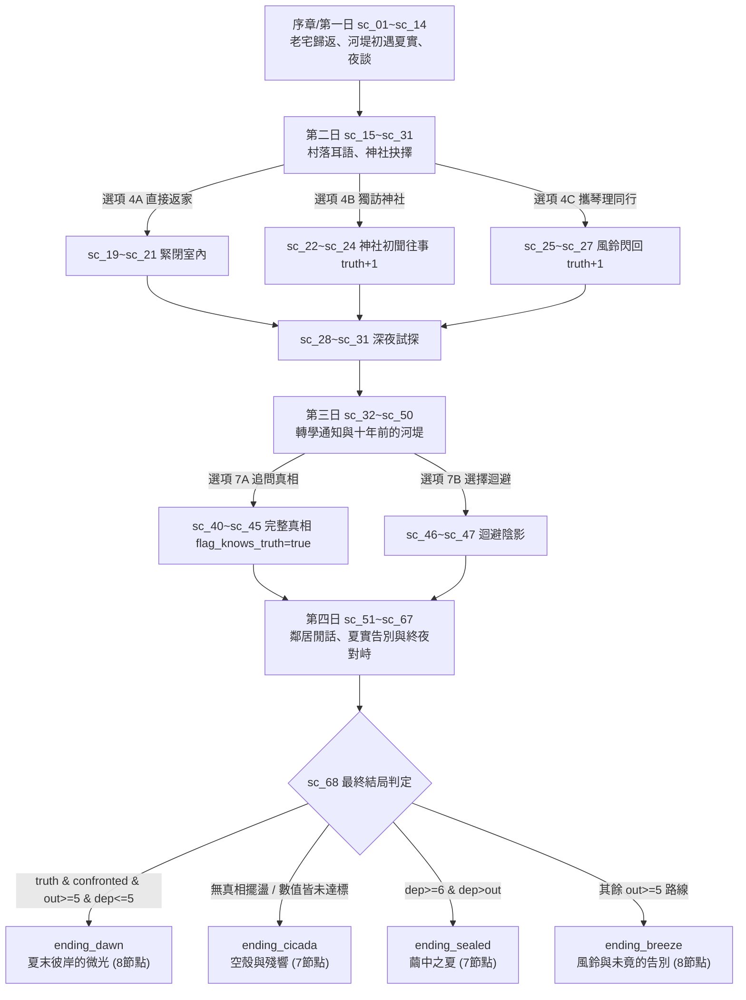

# 《夏末蟬鳴的彼岸》（Beyond the Summer Cicadas）— 完整敘事設計與分支腳本規格書

> **文件用途**：供遊戲程式開發者直接轉換為可執行劇本資料（JSON / JS 節點表）。  
> **分級與尺度**：全齡向 / PG-13 心理寫實群像劇（零露骨描寫，著重喪親孤獨、村落耳語、雙生共依存與跨越過去的微光）。  
> **總節點數**：**105 個可遊玩劇本節點**（共通與分支章節 `sc_01`–`sc_68` 含 `a/b` 分歧共 75 節點 ＋ 四條獨立結局線 30 節點）。

---

## 1. 世界觀、角色語氣與核心命題

### 1.1 舞台設定：八月末的「遠野村」
群山環抱的盆地農村。夏末的日光依然熾烈，空氣裡混著陳舊杉木、水田與遠處河堤的草腥味。  
父母因雨夜車禍驟逝後，十七歲的雙胞胎兄妹**小鳥遊 悠真**與**小鳥遊 琴理**，在暑期尾聲搬回外祖父母遺留的老木宅。對外人而言，他們只是兩個沉默寡言、遲遲不肯繳交轉學文件的孤兒；但在村人壓低嗓音的交頭接耳裡，這對兄妹早在十年前就曾是「不該太靠近水邊、也不該只剩彼此」的話題中心。

### 1.2 角色定調與對話聲線
* **小鳥遊 悠真（Yuma／主角視角）**  
  * **性格動機**：內省、善於觀察環境細節的兄長。他看似在照顧脆弱的妹妹，內心深處卻同樣害怕失去父母後的空洞——「保護琴理」不知不覺成了他逃避踏出家門、逃避長大的盾牌。  
  * **聲線**：冷靜、克制、富含感官細節（光影、水聲、茶溫、衣袖摩擦），不說空洞大道理。
* **小鳥遊 琴理（Kotori／雙胞胎妹妹）**  
  * **性格動機**：表面安靜易碎，實則對兩人封閉的避難所有著極度清醒且偏執的執著。她並不是不懂世事，而是見過村落的冷眼與十年前差點失去兄長的恐懼，寧可把窗板關死，也要將「只有我們兩個人」的八月永遠停住。  
  * **聲線**：輕柔、簡短、偶爾停頓，極少歇斯底里，卻總能用平靜的一句話把悠真釘在原地。
* **宮代 夏實（Natsumi／神社青梅竹馬）**  
  * **性格動機**：宮代神社神主家的女兒，十年前河岸意外的當事人。她以開朗日常的姿態遞出麥茶與關心，試圖替兄妹倆接通外界的空氣，背後卻揹負著長達十年的沉默罪惡感——當年正是她一時嫉妒與賭氣，成了掀開那場風波的起點。  
  * **聲線**：溫厚、務實、偶帶遲疑與自責，言談間總會不自覺望向河堤方向。

---

## 2. 嚴格素材與音效 ID 對照表

開發者實作時，所有場景指令皆對應以下固定 ID，不得任意更名：

### 2.1 角色立繪與表情（`[CHAR: char_id | EXPR: expr_id | POS: pos]`）
| 角色 ID | 角色名稱 | 允許表情 ID（`EXPR`） | 允許站位（`POS`） |
| :--- | :--- | :--- | :--- |
| `kotori` | 小鳥遊 琴理 | `idle`（靜立）、`smile`（微弱微笑）、`sad`（垂眸哀傷）、`tense`（緊繃戒備） | `left`、`center`、`right` |
| `natsumi` | 宮代 夏實 | `idle`（平和）、`smile`（溫柔笑意）、`sad`（愧疚失落）、`serious`（神色凝重） | `left`、`center`、`right` |
| `none` | 清空場上角色 | `—` | `—` |

### 2.2 背景與 CG（`[BG: bg_id]`）
* `bg_oldhouse`：外祖父母遺留的老木宅（庭院、玄關與緣廊）
* `bg_embankment`：遠野村河岸堤防與舊水閘（傍晚夕照與芒草）
* `bg_shrine`：宮代神社石階、鳥居與懸掛玻璃風鈴的屋簷
* `bg_nightroom`：深夜老宅和室（兩床並排的被褥、檯燈微光、木格窗縫）
* `cg_epilogue`：結局專用終幕靜畫（依四條結局呈現各自餘韻的意象構圖）

### 2.3 背景音樂與音效（`[BGM: track_id]` / `[SFX: sfx_id]`）
* **BGM**：`title_breeze`（微風序曲）、`summer_day`（盛夏日常）、`twilight_memory`（暮色追憶）、`tension_secret`（暗湧秘密）、`climax_choice`（終夜抉擇）
* **SFX**：`cicada_ambience`（夏末蟬鳴環境音）、`wind_chime`（神社玻璃風鈴）、`choice_confirm`（選項確認輕響）、`heartbeat`（緊繃心跳）、`door_slide`（木拉門／雨戶推拉聲）、`memory_flash`（十年前記憶閃回）

---

## 3. 變數系統、旗標與分岐路由總覽

### 3.1 隱藏數值與布林旗標（Initial State）
```json
{
  "dependency": 1,
  "outsideBond": 0,
  "truth": 0,
  "flag_opened_shutters": false,
  "flag_met_shrine_d2": false,
  "flag_hid_notice": false,
  "flag_knows_truth": false,
  "flag_confronted_kotori": false
}
```
* **`dependency`（共依存度，初始 `1`，範圍 `0–12`）**：傾向鎖緊門窗、排斥村落與學校、將彼此視為唯一避難所。
* **`outsideBond`（外界連結度，初始 `0`，範圍 `0–11`）**：願意回應夏實、直面耳語、承擔失去雙親後的現實未來。
* **`truth`（真相拼圖，初始 `0`，範圍 `0–3`）**：對十年前河岸意外與父母連夜離村原因的掌握度。

### 3.2 四結局判定規則（於終盤節點 `sc_68` 依序優先判定）
1. **結局 C：`ending_dawn`（夏末彼岸的微光 — 真實破繭結局）**  
   * **條件**：`flag_knows_truth === true && flag_confronted_kotori === true && outsideBond >= 5 && dependency <= 5`  
   * **意涵**：唯有得知十年前的真相，並誠實承認自己也在逃避，才能真正打開門窗走進微涼的初秋。
2. **結局 D：`ending_cicada`（空殼與殘響 — 裂痕失落結局）**  
   * **條件**：`(flag_knows_truth === false && outsideBond >= 3 && dependency >= 3) || (dependency <= 5 && outsideBond <= 4)`  
   * **意涵**：未觸及過去傷口便在內外之間猶疑拉扯，既守不住舊殼、也握不住明天，最終只剩空蕩的蟬蛻與清晨離去的腳步。
3. **結局 A：`ending_sealed`（繭中之夏 — 封閉共依存結局）**  
   * **條件**：`dependency >= 6 && dependency > outsideBond`  
   * **意涵**：選擇徹底關上木窗，將時間永遠停在無人打擾的八月末；溫柔卻令人窒息。
4. **結局 B：`ending_breeze`（風鈴與未竟的告別 — 單向離去結局）**  
   * **條件**：`ELSE`（即 `outsideBond >= 5 && outsideBond >= dependency`，但未同時達成真相與坦白條件）  
   * **意涵**：悠真踏出了家門並與夏實同行，卻把未解的心結留在了屋裡；風鈴聲裡藏著難以言說的餘痛。

### 3.3 分岐結構圖


---

## 4. 節點格式說明（供程式解析）
每個節點固定包含：
* **節點編號**（`sc_xx`）
* **舞台指令**（僅在切換或觸發時標註 `[BG]`、`[CHAR]`、`[BGM]`、`[SFX]`；切換選項確認時系統可自動播放 `[SFX: choice_confirm]`）
* **對話本體**（`說話者：台詞`，若為主角內心獨白則標註 `旁白`）
* **跳轉或條件**：`next: 目標節點`、`choices: [...]`、`[IF 條件] -> 節點` 或 `[END: 結局ID]`

---

## 5. 完整可遊玩分支腳本

### 【序章／第一日：歸返與蟬聲】（`sc_01` ~ `sc_14`）

#### `sc_01`
* `[BG: bg_oldhouse]`
* `[CHAR: none]`
* `[BGM: title_breeze]`
* `[SFX: cicada_ambience]`
* **旁白**：八月下旬的遠野村，熱氣像一層曬乾的鹽粒貼在柏油路上。公車在村口晃出一陣灰塵後便開走了，只留下我和琴理站在外公家生鏽的木門前。
* **旁白**：父母出事的那場暴雨好像已經隔了很久，又好像只是昨夜的事。手裡的紙箱還帶著東京公寓的氣味，門內卻只剩空屋積了幾年的塵土味。
* `next: sc_02`

#### `sc_02`
* `[SFX: door_slide]`
* `[CHAR: kotori | EXPR: idle | POS: center]`
* **旁白**：木拉門滑開時發出一聲乾澀的摩擦響。琴理比我先一步跨進玄關，白布鞋在榻榻米邊緣停住，整個人幾乎融進屋簷投下的陰影裡。
* **琴理**：……這裡比我想像的還要安靜呢，悠真。
* **悠真**：畢竟有好幾年沒人住了。先把行李放下來吧，我去看看水電有沒有問題。
* `next: sc_03`

#### `sc_03`
* `[CHAR: kotori | EXPR: sad | POS: center]`
* **旁白**：客廳面向庭院的那排木製雨戶全數關著，只從上緣木格滲進幾道灰白的微光。琴理站在暗處，肩線反而鬆了下來，彷彿外頭刺眼的日頭會把她曬傷。
* **琴理**：窗板……先不要全部拉開，可以嗎？外面好像有人一直往院子這邊看。
* `choices`:
  1. `{ label: "「還是透點氣吧，屋子悶太久會發霉的。」", effects: { flag_opened_shutters: true, outsideBond: +1 }, next: "sc_04a" }`
  2. `{ label: "「……好，今天先這樣。妳剛搭完長途車，先休息。」", effects: { flag_opened_shutters: false, dependency: +1 }, next: "sc_04b" }`

#### `sc_04a`
* `[SFX: door_slide]`
* `[CHAR: kotori | EXPR: tense | POS: center]`
* **旁白**：我伸手推開兩扇雨戶。陽光瞬間潑進榻榻米，照出半空中飛舞的浮塵。琴理微微縮起肩膀，別開臉避開那道光。
* **琴理**：……好亮。連蟬叫聲都變得好近。
* `next: sc_05`

#### `sc_04b`
* `[CHAR: kotori | EXPR: smile | POS: center]`
* **旁白**：琴理呼出一口極輕的氣，指尖無意識地勾住我襯衫下擺的布料，像是終於確認了安全範圍的邊界。
* **琴理**：嗯……只要裡面暗暗的，外面不管有誰在看，都進不來了。
* `next: sc_05`

#### `sc_05`
* `[BGM: summer_day]`
* `[CHAR: kotori | EXPR: idle | POS: center]`
* **旁白**：我們沉默地拆開兩個裝著舊餐具與制服的紙箱。傍晚前，我得去村口雜貨店買點米和電池，琴理卻盯著玄關那雙沒穿上的涼鞋，遲遲沒有動彈。
* **琴理**：我待在屋裡整理碗盤就好。悠真……早點回來喔。天黑之前一定要回來。
* `next: sc_06`

#### `sc_06`
* `[BG: bg_embankment]`
* `[CHAR: none]`
* `[SFX: cicada_ambience]`
* **旁白**：沿著河岸堤防往回走時，日頭已經斜到山脊後方。水閘下方傳來濁重的水聲，岸邊野生的芒草被風壓低，遠遠就能看見幾戶人家屋頂上浮著淡紫色的炊煙。
* **旁白**：我提著塑膠袋停在石階前。水面上映著橘紅色的雲影，莫名讓人想起小時候曾經來過這裡的某個黃昏——卻又怎麼也拼不齊當時的畫面。
* `next: sc_07`

#### `sc_07`
* `[CHAR: natsumi | EXPR: idle | POS: center]`
* **旁白**：石階上方傳來腳踏車煞車的輕響。一個綁著低馬尾、身上帶著淡淡線香與汗水氣味的女生停了下來，仔細端詳我好幾秒，才忽然睜大眼睛。
* **夏實**：……等一下。你是小鳥遊家的……悠真嗎？
* **悠真**：妳是……宮代神社的夏實？
* `next: sc_08`

#### `sc_08`
* `[CHAR: natsumi | EXPR: smile | POS: center]`
* **夏實**：真的是你！前幾天聽村公所的人說老宅有人整理，我還以為只是遠房親戚來看屋……你們真的搬回來住了嗎？
* **旁白**：她的笑容很暖，像是久未見面的老朋友，然而視線卻不自覺越過我的肩膀，朝沒人的堤防後方望了一眼。
* **夏實**：那……琴理呢？她今天沒有一起出來嗎？
* `choices`:
  1. `{ label: "「她不太習慣人多的地方，先待在屋裡整理。」", effects: { dependency: +1 }, next: "sc_09a" }`
  2. `{ label: "「嗯，我們這段時間都會住這兒。以後還請妳多照應。」", effects: { outsideBond: +1 }, next: "sc_09b" }`

#### `sc_09a`
* `[CHAR: natsumi | EXPR: serious | POS: center]`
* **旁白**：夏實的笑意凝住了一瞬，眼神短暫地垂向腳邊的水閘，像被什麼舊刺輕輕扎了一下。
* **夏實**：這樣啊……她還是，只肯待在你身邊嗎。
* `next: sc_10`

#### `sc_09b`
* `[CHAR: natsumi | EXPR: smile | POS: center]`
* **夏實**：別這麼客氣啦，我們小時候不也常在堤防邊跑來跑去嗎。有空的話，隨時帶琴理上神社乘涼吧。
* **旁白**：她說得輕快，指節卻緊緊扣著車把，彷彿在掩飾一句沒說出口的遲疑。
* `next: sc_10`

#### `sc_10`
* `[BGM: twilight_memory]`
* `[CHAR: natsumi | EXPR: sad | POS: center]`
* **旁白**：夏實從車籃裡拿出一小袋冰涼的麥茶包塞進我手裡，指尖微微一頓後，又從口袋摸出一枚繫著褪色紅繩、背面寫著神社舊編號的木牌護符，一併壓進我的掌心。
* **旁白**：暮色把堤防拉得很長，遠處幾位提著菜籃的村婦走過，目光在我身上停了半拍，隨即低聲交談著走遠。
* **夏實**：……遠野村很小，什麼風聲都傳得快。你們剛失去伯父伯母，如果聽到什麼不好聽的話，別太往心裡去。好嗎？
* **夏實**：麥茶拿回去給琴理降暑氣，至於那塊舊木牌……就當作我先借給你們的平安護符。哪天想找個安靜地方透氣，就拿著它回宮代神社找我還吧。
* `next: sc_11`

#### `sc_11`
* `[BG: bg_oldhouse]`
* `[SFX: door_slide]`
* `[CHAR: kotori | EXPR: idle | POS: center]`
* **旁白**：推開老宅木門時，屋裡已經點起昏黃的吊燈。琴理坐在緣廊邊，一聽見門響便抬起頭，目光精準地落在我提著的麥茶袋上。
* **琴理**：……好慢。你剛才在堤防邊，跟誰說話了？
* **悠真**：遇到神社的宮代夏實。她認出我們了，還拿了麥茶要我帶回來。
* `next: sc_12`

#### `sc_12`
* `[BG: bg_nightroom]`
* `[BGM: twilight_memory]`
* `[CHAR: kotori | EXPR: sad | POS: center]`
* **旁白**：夜深後，蟬鳴退去，換成草叢裡的秋蟲低低叫著。我們在和室裡鋪好兩床並排的被褥，中間只隔著伸手就能碰到的距離。
* **琴理**：傍晚我去院子收衣服的時候……聽到圍籬外面有兩個阿姨在說話。她們說，「小鳥遊家的孩子怎麼又回來了，以前不是連夜搬走的嗎」。
* **旁白**：黑暗中，她的聲音輕得像貼在耳膜上的風。
* `next: sc_13`

#### `sc_13`
* `[CHAR: kotori | EXPR: tense | POS: center]`
* `[SFX: heartbeat]`
* **琴理**：悠真……我們是不是真的很奇怪？爸媽不在之後，我連跟別人對上視線都覺得噁心。只有你在的時候，我才覺得自己還活著。
* `choices`:
  1. `{ label: "「別管外面說什麼。只要我們兩個在一起就夠了。」", effects: { dependency: +1 }, next: "sc_14a" }`
  2. `{ label: "「沒有誰奇怪。只是剛換環境……明天我們一起出去走走吧。」", effects: { outsideBond: +1 }, next: "sc_14b" }`

#### `sc_14a`
* `[CHAR: kotori | EXPR: smile | POS: center]`
* **旁白**：琴理在昏暗中輕輕靠過來，額頭幾乎抵著我的肩膀，唇角浮起一絲既安心又脆弱的弧度。
* **琴理**：嗯……我也只需要悠真就夠了。誰都不要進來。
* `next: sc_15`

#### `sc_14b`
* `[CHAR: kotori | EXPR: sad | POS: center]`
* **旁白**：室內的空氣沉默了幾秒。琴理沒有立刻回答，只是翻過身背對著我，將被角拉到下巴處。
* **琴理**：……如果悠真想出去的話，我會試著跟上的。
* `next: sc_15`

---

### 【第二日：風鈴與耳語】（`sc_15` ~ `sc_31`）

#### `sc_15`
* `[BG: bg_oldhouse]`
* `[BGM: summer_day]`
* `[SFX: cicada_ambience]`
* `[CHAR: none]`
* **旁白**：第二天上午，熱氣比昨天更早爬上木簷。我整理昨晚夏實給的麥茶袋時，再次看見擺在一旁的神社編號木牌護符——昨晚只顧著安撫琴理，差點忘了她故意留下「拿回神社還我」這個說詞的心意。
* **旁白**：今天剛好得去村公所問郵件的事，順道把這塊木牌送回宮代神社也不遠，但琴理已經換好出門用的白開衫，正安靜地在玄關等我。
* `next: sc_16`

#### `sc_16`
* `[BG: bg_embankment]`
* `[CHAR: kotori | EXPR: idle | POS: left]`
* `[IF flag_opened_shutters == true]` **旁白**：早晨拉開窗板時她雖沒說什麼，走上堤防後卻仍下意識將領口拉高，緊緊跟在我左後方半步的位置。
* `[ELSE]` **旁白**：昨天沒拉開的窗板讓她在清晨格外蒼白，走出家門才幾分鐘，便像不適應強光似地微瞇起眼。
* **旁白**：經過路口公車站牌時，幾名等待公車的婦人正好停下話頭，視線在我們緊挨著的肩頭掃過。壓低的竊竊私語順著熱風飄了過來——「聽說轉學手續根本還沒交」、「兩個人每天都像連在一起似的，門窗關得死緊……」
* `next: sc_17`

#### `sc_17`
* `[CHAR: kotori | EXPR: tense | POS: left]`
* **旁白**：琴理的腳步猛地釘在柏油路上，抓著針織衫下擺的手指白得發青。她沒有回頭看那些人，卻把視線死死鎖在自己的鞋尖上。
* **琴理**：……悠真，我們回去吧。這裡的空氣好臭，我喘不過氣了。
* `next: sc_18`

#### `sc_18`
* `[CHAR: kotori | EXPR: sad | POS: left]`
* **旁白**：斜前方就是通往宮代神社的長石階，林蔭底下隱約傳來玻璃風鈴被風撞響的清脆聲。口袋裡的木牌護符隔著布料貼著我的掌心。
* `choices`:
  1. `{ label: "「好，我陪妳先回家。護符改天再還給夏實。」", effects: { dependency: +1 }, next: "sc_19" }`
  2. `{ label: "「妳在前面的樹蔭等我五分鐘，我去把護符還給夏實就下來。」", effects: { flag_met_shrine_d2: true, outsideBond: +1 }, next: "sc_22" }`
  3. `{ label: "「再走幾步就是神社了，上面涼快又安靜，一起上去看看吧。」", effects: { flag_met_shrine_d2: true, outsideBond: +1 }, next: "sc_25" }`

#### `sc_19`
* `[BG: bg_oldhouse]`
* `[SFX: door_slide]`
* `[CHAR: kotori | EXPR: idle | POS: center]`
* **旁白**：我沒再看神社的方向，牽著琴理的手腕轉頭往老宅走。木門重新拉上的那一刻，外頭的蟬鳴與人聲彷彿同時隔絕在一層厚玻璃之外。
* `next: sc_20`

#### `sc_20`
* `[CHAR: kotori | EXPR: smile | POS: center]`
* **旁白**：回到屋裡不到五分鐘，琴理的呼吸就平穩了下來。她跪坐在矮桌前，小心翼翼地把昨晚剩的麥茶倒進兩個缺了邊角的小杯裡。
* **琴理**：你看，果然還是家裡最好。外面的人根本什麼都不懂，只是喜歡看別人落魄的樣子而已。
* `next: sc_21`

#### `sc_21`
* `[BGM: twilight_memory]`
* `[CHAR: kotori | EXPR: sad | POS: center]`
* **悠真**：……嗯，或許吧。
* **旁白**：我低頭喝了一口微溫的茶，口袋裡那塊沒能還出去的神社木牌卻沉甸甸地壓在腿側，像一個故意被我延後打開的問號。
* `next: sc_28`

#### `sc_22`
* `[BG: bg_shrine]`
* `[SFX: wind_chime]`
* `[CHAR: natsumi | EXPR: idle | POS: center]`
* **旁白**：安頓好琴理在坡下的榕樹蔭等我後，我獨自走上石階。神社境內比山下涼快許多，一排玻璃風鈴在屋簷下叮噹作響，夏實正握著竹掃帚清掃落葉。
* **夏實**：悠真？你怎麼一個人上來了？
* **悠真**：昨晚妳塞給我的那塊神社木牌，剛好順路，我想說拿上來還妳。
* `next: sc_23`

#### `sc_23`
* `[CHAR: natsumi | EXPR: serious | POS: center]`
* **旁白**：夏實接過木牌，指腹在磨損的字跡上頓了一下，神色忽然正經起來。
* **夏實**：……琴理在下面等你嗎？剛才我在郵局門口也聽見那些阿姨在嚼舌根了。十年前也是這樣……村裡的人只要看不順眼，就會把別人家形容得像怪談一樣。
* **悠真**：十年前？我們小時候搬去東京，不是因為爸爸換工作嗎？
* `[EFFECT: truth += 1]`
* `next: sc_24`

#### `sc_24`
* `[CHAR: natsumi | EXPR: sad | POS: center]`
* **旁白**：夏實猛地咬住下唇，眼神閃過一絲慌亂與深沉的疲憊。遠方山脊忽然傳來一聲沉悶的夏雷。
* **夏實**：……對不起，這件事不能在這裡三言兩語講完。琴理一個人在下面等，太久會不安的——你先回去陪她吧，別讓她等急了。
* `next: sc_28`

#### `sc_25`
* `[BG: bg_shrine]`
* `[SFX: wind_chime]`
* `[CHAR: kotori | EXPR: tense | POS: left]`
* `[CHAR: natsumi | EXPR: idle | POS: right]`
* **旁白**：我拉著琴理走上最後幾階石梯。穿過朱紅鳥居時，正在屋簷下掛風鈴的夏實回過頭，視線落在緊緊並肩的我們身上，整個人微微一僵。
* **夏實**：……琴理？好久不見了，妳還記得我嗎？
* `next: sc_26`

#### `sc_26`
* `[CHAR: natsumi | EXPR: smile | POS: right]`
* `[CHAR: kotori | EXPR: sad | POS: left]`
* `[SFX: memory_flash]`
* **旁白**：琴理沒有回話，只往我身後退了半步，隔著我的肩膀抬眼看向走廊上方那串隨風搖晃的藍白玻璃風鈴。那一瞬間，她的指尖無意識地顫了一下，彷彿被風鈴的尾音刺到了什麼。
* **琴理**：……水聲。
* **悠真**：琴理？
* `[EFFECT: truth += 1]`
* `next: sc_27`

#### `sc_27`
* `[CHAR: kotori | EXPR: tense | POS: left]`
* `[CHAR: natsumi | EXPR: serious | POS: right]`
* **旁白**：琴理像剛從冷水裡抽回意識，立刻低下頭死死扯住我的袖口。夏實伸到半空想遞水杯的手就這樣停在風裡。
* **琴理**：悠真，我們回去吧。這裡的風鈴……聲音太吵了。
* **旁白**：我只能對夏實抱歉地點點頭，任由琴理拉著我走下石階。回頭望時，夏實仍一動不動地站在風鈴底下看著我們。
* `next: sc_28`

#### `sc_28`
* `[BG: bg_oldhouse]`
* `[BGM: tension_secret]`
* `[CHAR: kotori | EXPR: idle | POS: center]`
* `[IF flag_met_shrine_d2 == true]` **旁白**：傍晚替屋裡擦拭桌面時，琴理忽然靠得很近，鼻尖輕輕動了動——神社杉木與線香的餘味還留在我的衣領上。她什麼都沒問，卻把擦過桌面的抹布擰得極乾。
* `[ELSE]` **旁白**：一整天都沒有再出門。屋裡靜得連屋樑木頭熱脹冷縮的微響都聽得見，琴理把餐具排列得整整齊齊，彷彿這樣就能把外頭的時間擋在門外。
* `next: sc_29`

#### `sc_29`
* `[BG: bg_nightroom]`
* `[CHAR: kotori | EXPR: tense | POS: center]`
* **旁白**：午夜時分，山風拍打著木格子窗，發出空洞的叩響。我醒來時，發現琴理沒有睡，她抱著膝蓋坐在微弱的夜燈旁，膝上攤著一張父母從前的舊合照。
* **琴理**：悠真，你睡著了嗎？
* **悠真**：還沒。怎麼還不睡？
* `next: sc_30`

#### `sc_30`
* `[CHAR: kotori | EXPR: sad | POS: center]`
* **旁白**：她把手指壓在照片邊緣，聲音低得幾乎要被屋外的風吞沒。
* **琴理**：如果有一天，你也開始覺得我太麻煩、覺得村裡的人說得沒錯……你會不會也像他們一樣，把我一個人留在岸邊？
* `choices`:
  1. `{ label: "「不會的。就算全世界都覺得我們奇怪，我也不會放手。」", effects: { dependency: +1 }, next: "sc_31a" }`
  2. `{ label: "「別胡思亂想。我不會丟下妳，但我們也不能永遠關在屋子裡。」", effects: { outsideBond: +1 }, next: "sc_31b" }`

#### `sc_31a`
* `[CHAR: kotori | EXPR: smile | POS: center]`
* **旁白**：琴理輕輕握住我的手腕，五指收攏的力道不大，卻像一把貼合著皮膚扣上的鎖。
* **琴理**：記住你說過的話喔，悠真。這輩子都不准反悔。
* `next: sc_32`

#### `sc_31b`
* `[CHAR: kotori | EXPR: tense | POS: center]`
* **旁白**：她收回原本伸向我的手，抱緊膝蓋把下巴埋進睡衣領口，整個人重新縮成一團看不出情緒的剪影。
* **琴理**：……「不能永遠關在屋子裡」，聽起來跟那些大人說的話好像喔。
* `next: sc_32`

---

### 【第三日：沉沒的十年前】（`sc_32` ~ `sc_50`）

#### `sc_32`
* `[BG: bg_oldhouse]`
* `[BGM: summer_day]`
* `[SFX: cicada_ambience]`
* `[CHAR: none]`
* **旁白**：第三天清晨，空氣悶熱得像要下起夏末最後一場雷雨。我去庭院門口取報紙時，在生鏽的鐵皮信箱裡摸到兩封信——一封是鎮上高中的轉學報到催辦通知，另一封則是發黃的舊牛皮紙信封，收件人寫著母親的名字，寄件欄印著「宮代神社」。
* **旁白**：那封舊信夾在外公沒來得及寄出的雜物裡，封口早已受潮微張。正當我盯著信封發愣時，身後的紙門輕輕拉開了。
* `next: sc_33`

#### `sc_33`
* `[CHAR: kotori | EXPR: tense | POS: center]`
* **旁白**：琴理一眼就認出了我左手拿著的學校公文信封。她的呼吸頓時停了半拍，赤腳踩在緣廊木板上走過來，伸手想把那份通知單接過去。
* **琴理**：……原來已經寄來了啊。
* `next: sc_34`

#### `sc_34`
* `[CHAR: kotori | EXPR: sad | POS: center]`
* **琴理**：悠真，九月馬上就要開學了……可是只要去那間學校，村裡所有認識我們姓氏的人都會盯著我看。再等幾天把這件事放一放，好不好？先不要交出去。
* `choices`:
  1. `{ label: "「……好。我先把它收進抽屜裡，這幾天不去想這件事。」", effects: { flag_hid_notice: true, dependency: +1 }, next: "sc_35a" }`
  2. `{ label: "「不能再拖了，琴理。文件我先帶著，下午去鎮上問清楚手續。」", effects: { flag_hid_notice: false, outsideBond: +1 }, next: "sc_35b" }`

#### `sc_35a`
* `[CHAR: kotori | EXPR: smile | POS: center]`
* **旁白**：琴理仔細地將通知單對摺、壓平，鎖進矮櫃最底層的小抽屜裡。鑰匙轉動的輕響讓她露出彷彿鬆了一口氣的笑。
* **琴理**：嗯，只要收起來，什麼都還沒開始。
* `next: sc_36`

#### `sc_35b`
* `[CHAR: kotori | EXPR: tense | POS: center]`
* **旁白**：琴理伸出的手停在半空，緩緩攥成拳收了回去。她垂下眼簾，聲音冷得不像平時的她。
* **琴理**：……悠真，你是不是已經開始覺得這間屋子太窄、覺得我拖累你了？
* `next: sc_36`

#### `sc_36`
* `[BG: bg_embankment]`
* `[BGM: twilight_memory]`
* `[CHAR: none]`
* **旁白**：午後的烏雲越壓越低，把河水染成一片鉛灰。我藉口出來買晚餐食材，將那封給母親的「宮代神社」舊信塞在口袋裡，獨自走到堤防的水閘旁。
* **旁白**：悶熱的風捲起岸邊芒草。越靠近這座混凝土水閘，胸口就越發湧上一股說不清的窒息感。
* `next: sc_37`

#### `sc_37`
* `[CHAR: natsumi | EXPR: serious | POS: center]`
* **旁白**：石階上早已站著一個人。夏實手裡提著一只竹編舊燈籠架，看見我走近時沒有露出意外的神色，反而像是終於等到該來的時刻。
* **夏實**：……我就猜你今天會走來這裡。你手裡拿的，是以前我外公寄給伯母的信嗎？
* `next: sc_38`

#### `sc_38`
* `[CHAR: natsumi | EXPR: sad | POS: center]`
* `[IF flag_met_shrine_d2 == true]` **夏實**：昨天在神社沒能把話說完……昨晚我一直沒睡好。如果再不告訴你，我怕你們兄妹真的會再被這個村子逼進死胡同裡。
* `[ELSE]` **夏實**：這幾天我看著你們把窗戶關得那麼緊，我就知道……你們根本不知道十年前發生過什麼事，對不對？
* `next: sc_39`

#### `sc_39`
* `[BGM: tension_secret]`
* `[SFX: memory_flash]`
* `[CHAR: natsumi | EXPR: serious | POS: center]`
* **旁白**：記憶裡的碎片忽然在水聲中翻湧——冰冷的河水、白色的草鞋、母親發抖的背影。我看著夏實泛紅的眼眶，指節捏緊了口袋裡的舊信封。
* `choices`:
  1. `{ label: "「把十年前的事全部告訴我吧，夏實。我不想再當個什麼都不知道的人。」", effects: { truth: +2, outsideBond: +1 }, next: "sc_40" }`
  2. `{ label: "「如果那是會讓琴理更痛苦的事……算了，過去的就別再翻出來了。」", effects: { dependency: +1 }, next: "sc_46" }`

#### `sc_40`
* `[SFX: heartbeat]`
* `[CHAR: natsumi | EXPR: sad | POS: center]`
* **旁白**：夏實閉上雙眼，深吸了一口潮濕的河風。她的聲音在蟬鳴裡有些發顫，每一個字卻咬得極清楚。
* **夏實**：十年前的盂蘭盆節前夜，也是像今天這樣快下雨的傍晚。那時候我才八歲……因為忌妒你每次放水燈都只牽著琴理的手，不肯理我，就賭氣把琴理掉在石階上的一隻涼鞋踢到水閘邊的濕石頭上。
* `next: sc_41`

#### `sc_41`
* `[SFX: memory_flash]`
* `[CHAR: natsumi | EXPR: serious | POS: center]`
* **夏實**：我本來以為她不敢去撿，結果琴理為了不讓你擔心她弄丟鞋子，自己爬下青苔石階去撈……水閘剛好在放水，她整個人滑進急流裡。你什麼都沒想就跟著跳下去拉住她，兩個人差點一起被捲走。
* **旁白**：我腦中嗡地一聲，喉嚨像被十年前那股混濁的河水瞬間灌滿——難怪每次聽見急促的流水與風鈴聲，琴理總會無意識發抖。
* `next: sc_42`

#### `sc_42`
* `[CHAR: natsumi | EXPR: sad | POS: center]`
* **夏實**：是我外公衝進水裡把你們兩個硬拉上來的，他的右腳也從那時候起落下了舊傷。可是更可怕的不是意外本身……而是你們出院以後，村裡那些大人的嘴。
* **夏實**：琴理受了驚嚇好幾週開不了口，只要離開你的視線就會呼吸困難。村裡的老一輩卻開始亂傳，說你們雙胞胎「八字黏得太死、差點一起拖下水是水鬼忌諱」，甚至有人當面勸伯父伯母把你們分開送去不同親戚家寄養。
* `next: sc_43`

#### `sc_43`
* `[CHAR: natsumi | EXPR: serious | POS: center]`
* **夏實**：那天半夜，伯父氣得一句話沒說就收拾行李帶你們離開遠野村。臨走前，伯母塞給我這封信的複本，要我別一輩子怪自己，也拜託大人們別在你們長大後重提這件事……可這十年來，我每一天都在想，要是我當年沒踢走那隻鞋子，琴理是不是就不用這麼害怕這世界。
* `[EFFECT: flag_knows_truth = true, truth += 1]`
* `next: sc_44`

#### `sc_44`
* `[BG: bg_shrine]`
* `[SFX: wind_chime]`
* `[CHAR: natsumi | EXPR: sad | POS: center]`
* **旁白**：第一滴雨點落下時，夏實拉著我跑上宮代神社的屋簷避雨。頭頂的玻璃風鈴被濕風吹得急促碰撞。
* **夏實**：悠真，我今天說出來不是為了求你原諒我。只是我看著你們兄妹把門窗關得死緊，好怕你們又像十年前一樣，以為這世界除了彼此之外全都是敵人。
* `next: sc_45`

#### `sc_45`
* `[CHAR: natsumi | EXPR: idle | POS: center]`
* **旁白**：雨點順著屋簷滴成一道簾幕。我望著模糊的遠野村屋頂，胸口忽然落下一種更冰冷也更清醒的痛感——這整個夏天，我自以為在替琴理擋住外面的風雨，其實何嘗不是在利用她的脆弱，替不敢獨自面對父母離世的自己找一個不需要長大的理由？
* `next: sc_48`

#### `sc_46`
* `[CHAR: natsumi | EXPR: sad | POS: center]`
* **旁白**：夏實怔怔地看著我，手裡的燈籠架無力地垂落下來，眼底浮起深深的無奈與失望。
* **夏實**：……悠真，你跟十年前一樣啊。只要能把琴理護在身後，你就連自己到底在逃避什麼都不肯看一眼嗎？
* `next: sc_47`

#### `sc_47`
* `[BG: bg_shrine]`
* `[SFX: wind_chime]`
* `[CHAR: natsumi | EXPR: serious | POS: center]`
* **旁白**：陣雨驟然傾瀉，我默默跟著夏實退上神社石階的屋簷。風鈴在潮濕的風裡亂響，我們之間隔著一段跨不過的沉默。
* **夏實**：就算你不問，村裡那些閒言碎語也不會自己停下來。總有一天，你們還是得面對這扇門外面的世界。
* **旁白**：雨勢稍歇時我道了謝便下山，懷裡那封沒拆開的舊信早已被掌心的汗浸得發軟。
* `next: sc_48`

#### `sc_48`
* `[BG: bg_oldhouse]`
* `[BGM: tension_secret]`
* `[SFX: door_slide]`
* `[CHAR: kotori | EXPR: tense | POS: center]`
* **旁白**：踩著微暗的毛毛雨推開老宅木門時，客廳沒有開燈。琴理就坐在玄關旁的第一張階梯上，雙手抱膝靜靜看著門口，不知已經等了多久。
* **琴理**：……你身上有河水跟雨的味道。你又去見宮代同學了，對吧？
* `next: sc_49`

#### `sc_49`
* `[CHAR: kotori | EXPR: sad | POS: center]`
* `[IF flag_knows_truth == true]` **旁白**：我看著她蒼白細瘦的手腕，十年前水中緊抓不放的觸感彷彿又回到掌心，一時間竟不敢直視她的眼睛。
* `[ELSE]` **旁白**：我低頭脫掉濕透的鞋子，避開她過於清明卻又脆弱的目光，隨口答了一句只是去買東西遇上陣雨。
* **琴理**：剛才有個鄰居婆婆站在圍籬外喊門，問我們家到底還缺什麼、大人怎麼一直沒出現……我沒有去開門。我怕只要開了一條縫，他們就會像看怪物一樣往裡面探頭。
* `next: sc_50`

#### `sc_50`
* `[BG: bg_nightroom]`
* `[CHAR: kotori | EXPR: tense | POS: center]`
* **旁白**：夜裡雷聲滾過遠山。琴理早早熄掉了和室的檯燈，只留窗縫漏進來的灰藍月色照亮她微微發顫的側臉。
* **琴理**：氣象預報說，明天還會有更大的雨。悠真……明天我們哪裡都不要去，把雨戶全部關起來，好不好？
* `next: sc_51`

---

### 【第四日：斷裂與抉擇之夜】（`sc_51` ~ `sc_68`）

#### `sc_51`
* `[BG: bg_oldhouse]`
* `[BGM: tension_secret]`
* `[SFX: cicada_ambience]`
* `[CHAR: none]`
* **旁白**：第四天午後，大雨短暫停歇，太陽從濕雲縫裡鑽出來，將木牆蒸出一股濃烈的陳舊杉木氣味。屋外的蟬鳴聲嘶力竭地響成一片——那是八月最後幾天的鳴叫。
* **旁白**：圍籬外忽然響起腳步聲與放東西的碰響。一名村裡的婦人隔著半掩的木門放下一袋水梨，嗓音卻刻意不高不低地穿透庭院：「都搬來好幾天了還整天門窗緊閉的，不像正常人家啊……爸媽不在了，兩個小孩總不能一直關在一起過日子吧。」
* `next: sc_52`

#### `sc_52`
* `[CHAR: kotori | EXPR: tense | POS: center]`
* **旁白**：腳步聲遠去後，庭院重新陷入死寂。琴理站在紙門內側，沒有哭，也沒有反駁，只是面無表情地走向緣廊，伸手抓起第一塊沉重的木製雨戶滑進軌道。
* `next: sc_53`

#### `sc_53`
* `[SFX: door_slide]`
* `[CHAR: kotori | EXPR: sad | POS: center]`
* **旁白**：木板撞擊門框發出一聲悶響。在最後一扇窗板即將徹底遮蔽天光前，我跨步上前握住了她的手腕。
* **悠真**：琴理，停下來。這樣關住窗戶，事情不會變好的。
* **琴理**：放開我……不關起來的話，他們的聲音就會一直進來啊。
* `next: sc_54`

#### `sc_54`
* `[BG: bg_oldhouse]`
* `[BGM: twilight_memory]`
* `[SFX: door_slide]`
* `[CHAR: natsumi | EXPR: serious | POS: center]`
* **旁白**：就在屋內僵持不下時，院子外頭傳來叩門的輕響。我鬆開琴理走出玄關，看見夏實撐著一把摺疊傘站在木門外，手裡拿著一張鎮上公車時刻表與學校聯絡單。
* **夏實**：悠真……明天上午九點開學報到就截止了。我只是想問一句，你真的打算讓自己跟琴理一起被鎖在這間房子裡嗎？
* `choices`:
  1. `{ label: "「謝謝妳一直為我們奔走，夏實。明天……我想試著帶琴理出來。」", effects: { outsideBond: +1 }, next: "sc_55a" }`
  2. `{ label: "「我們家裡的事外人插不了手。妳以後不用再特地跑這一趟了。」", effects: { dependency: +1 }, next: "sc_55b" }`

#### `sc_55a`
* `[BG: bg_embankment]`
* `[CHAR: natsumi | EXPR: smile | POS: center]`
* **旁白**：夏實緊繃的肩線稍微鬆開，眼底閃過一絲溫熱的微光。她將時刻表輕輕放進我手裡，退後一步站在堤防坡道上。
* **夏實**：太好了……那明天早上，我在鳥居底下的斜坡等你們。不管你們幾點出來，我都會等。
* `next: sc_56`

#### `sc_55b`
* `[BG: bg_embankment]`
* `[CHAR: natsumi | EXPR: sad | POS: center]`
* **旁白**：夏實站在潮濕的風裡，嘴唇微微動了一下，卻沒再說出任何勸阻的話。她慢慢合起傘，轉身走上堤防小路。
* **夏實**：……原來我這十年以為能贖罪的關心，對你們來說也只是多餘的打擾啊。對不起，悠真。
* `next: sc_56`

#### `sc_56`
* `[BG: bg_nightroom]`
* `[BGM: climax_choice]`
* `[SFX: heartbeat]`
* `[CHAR: kotori | EXPR: tense | POS: center]`
* **旁白**：入夜後，夏末最後的風雨再次拍打屋瓦。和室的矮桌上只點著一盞微黃的檯燈，我們相對而坐，中間隔著無法再假裝看不見的現實。
* `[IF flag_hid_notice == true]` **旁白**：琴理默默從底層抽屜裡取出那封被我們刻意藏起來的轉學通知，放在檯燈光暈正中央。
* `[ELSE]` **旁白**：琴理盯著桌上那封我始終帶在身邊、邊角已經磨毛的轉學通知，指尖輕輕摩挲著茶杯邊緣。
* `next: sc_57`

#### `sc_57`
* `[CHAR: kotori | EXPR: sad | POS: center]`
* **琴理**：我其實不是傻瓜，悠真。我知道我們不可能一輩子當七歲的小孩，也不可能永遠靠外公留下的這點積蓄過活。
* **琴理**：可是……只要一想到明天你踏出這扇門、走進學校跟人群裡，你就不再只屬於「這裡」了。一想到有天你會離我越來越遠，我就覺得胸口像溺水一樣痛。
* `next: sc_58`

#### `sc_58`
* `[CHAR: kotori | EXPR: tense | POS: center]`
* **琴理**：爸媽已經不在了。村裡的人都用看異類的眼神打量我們。如果連你都要往外面走……那十年前在水裡的時候，你為什麼要那麼用力抓住我的手？
* `next: sc_59`

#### `sc_59`
* `[SFX: heartbeat]`
* `[CHAR: kotori | EXPR: sad | POS: center]`
* **旁白**：和室陷入深沉的寂靜，只有一隻垂死的秋蟬撞在窗外木板上發出微弱的撲翅聲。看著眼前顫抖卻固執的妹妹，我終於明白今晚必須給出一個無法閃躲的回答。
* `next: sc_60`

#### `sc_60`
* `[IF flag_knows_truth == true]` -> `sc_61`
* `[ELSE]` -> `sc_64`

#### `sc_61`
* `[BGM: climax_choice]`
* `[SFX: memory_flash]`
* `[CHAR: kotori | EXPR: tense | POS: center]`
* **旁白**：我深吸一口氣，伸手輕輕按住琴理冰涼的雙肩。夏實今天在雨中揭開的十年前真相，以及我自己內心深處的怯懦，此刻全數攤在眼前。
* `choices`:
  1. `{ label: "「十年前河邊的事我都想起來了……而且這陣子躲起來不敢面對未來的，其實是我自己。」", effects: { flag_confronted_kotori: true, outsideBond: +1 }, next: "sc_62" }`
  2. `{ label: "「……別想了，十年前的記憶已經過去了。妳只要記得我會護著妳就好。」", effects: { dependency: +1 }, next: "sc_63" }`

#### `sc_62`
* `[CHAR: kotori | EXPR: sad | POS: center]`
* **悠真**：我一直假裝自己是在保護害怕人群的妳……其實我也一樣害怕。沒有爸媽的東京、沒有大人的未來，我只要一想到要獨自承擔就想逃跑，所以才躲進「只有我們兩個人」的屋子裡。
* **旁白**：聽見這句話的瞬間，琴理緊繃了好幾天的肩膀終於垮了下來。滾燙的眼淚一顆顆砸在榻榻米上，彷彿那道橫亙在彼此之間十年的秘密終於被真正看見。
* **琴理**：……原來悠真也這麼害怕啊。我還以為，只有我是個沒用的膽小鬼。
* `next: sc_66`

#### `sc_63`
* `[CHAR: kotori | EXPR: idle | POS: center]`
* **旁白**：我將剛湧到嘴邊的真相硬生生嚥了回去，只把她輕輕擁入懷裡。琴理安靜地靠在我胸口，眼神卻慢慢黯淡下去——她似乎隱約察覺，我依然用著「溫柔的兄長」這張面具把她隔在真實之外。
* `next: sc_66`

#### `sc_64`
* `[CHAR: kotori | EXPR: tense | POS: center]`
* **旁白**：我始終不知道十年前父母連夜搬離遠野村的真正原因，面對琴理帶著絕望與質詢的眼神，心口像被一團迷霧堵住，只能憑著當下的直覺回應。
* `choices`:
  1. `{ label: "「我們不能把人生都關在這裡……跟我一起試著面對明天，好嗎？」", effects: { outsideBond: +1 }, next: "sc_65a" }`
  2. `{ label: "「別哭了，琴理。既然外面的世界讓妳這麼痛苦，那我們就留在這裡。」", effects: { dependency: +1 }, next: "sc_65b" }`

#### `sc_65a`
* `[CHAR: kotori | EXPR: sad | POS: center]`
* **旁白**：琴理輕輕搖了搖頭，嘴角扯出一抹苦澀得幾乎看不見的笑。
* **琴理**：面對什麼呢……悠真，你連我們十年前為什麼必須逃離這裡都不敢去弄清楚，又要怎麼帶我走出去？
* `next: sc_66`

#### `sc_65b`
* `[CHAR: kotori | EXPR: smile | POS: center]`
* **旁白**：琴理緩緩停止了顫抖，將額頭輕輕抵在我的肩窩上。那抹滿足而空洞的微笑，在微弱檯燈下顯得近乎凝固。
* **琴理**：嗯……只要悠真也答應留下來，外面不管說什麼都無所謂了。
* `next: sc_66`

#### `sc_66`
* `[BG: bg_nightroom]`
* `[BGM: climax_choice]`
* `[CHAR: kotori | EXPR: idle | POS: center]`
* **旁白**：漫長的夏夜一點一滴流逝。雨勢在天亮前漸漸歇止，木格窗縫隙外的天色由墨黑轉成淡灰的青色，夏末最後一個清晨正靜靜逼近門檻。
* `next: sc_67`

#### `sc_67`
* `[SFX: wind_chime]`
* `[CHAR: kotori | EXPR: sad | POS: center]`
* **旁白**：晨風拂過山坡，遠方宮代神社的風鈴似乎遙遙傳來一聲極輕的清響。琴理抬起頭，最後一次望進我的眼底，將所有的選擇權交到我手裡。
* **琴理**：悠真……天快亮了。你要怎麼選？
* `choices`:
  1. `{ label: "「把木窗栓起來吧。這個夏天，我們哪裡也不去了。」", effects: { dependency: +2 }, next: "sc_68" }`
  2. `{ label: "「走吧，琴理。去把轉學通知交出去，也去見夏實一面。」", effects: { outsideBond: +2 }, next: "sc_68" }`
  3. `{ label: "「如果還是會怕，走慢一點沒關係——但我不會再替妳關上這扇門了。」", effects: { outsideBond: +1 }, next: "sc_68" }`

#### `sc_68`
* `[EVALUATE ENDING]`
* `[IF flag_knows_truth == true && flag_confronted_kotori == true && outsideBond >= 5 && dependency <= 5]` -> `sc_end_dawn_01`
* `[ELSE IF (flag_knows_truth == false && outsideBond >= 3 && dependency >= 3) || (dependency <= 5 && outsideBond <= 4)]` -> `sc_end_cicada_01`
* `[ELSE IF dependency >= 6 && dependency > outsideBond]` -> `sc_end_sealed_01`
* `[ELSE]` -> `sc_end_breeze_01`

---

### 【結局 A：繭中之夏】（`ending_sealed`｜7 節點：`sc_end_sealed_01` ~ `sc_end_sealed_07`）

#### `sc_end_sealed_01`
* `[BG: bg_nightroom]`
* `[BGM: tension_secret]`
* `[SFX: door_slide]`
* `[CHAR: kotori | EXPR: smile | POS: center]`
* **旁白**：我起身走到緣廊邊，將最後一塊沉重的木製雨戶推到底，接著把鐵栓一格一格扣死。晨光被徹底截斷在門板之外，和室裡只剩下那盞暖黃的舊檯燈。
* **琴理**：……這樣就好安靜了呢。
* `next: sc_end_sealed_02`

#### `sc_end_sealed_02`
* `[CHAR: kotori | EXPR: idle | POS: center]`
* **旁白**：早上八點多，木門外傳來細碎的腳步聲，夏實隔著圍籬輕聲喚了兩次我的名字。琴理只是伸手替我理平睡衣領口，我們誰也沒有走出去應門。過了十幾分鐘，外頭的腳步聲終於踩著碎石坡道遠去了。
* `next: sc_end_sealed_03`

#### `sc_end_sealed_03`
* `[BG: bg_oldhouse]`
* `[CHAR: kotori | EXPR: smile | POS: center]`
* **旁白**：日曆還停在八月最後一頁，誰也沒有去撕。玄關沒有掛上新的鎮立高中制服，郵箱裡催繳報到單的紙張也被我們安靜地摺起來放進木箱深處。村裡的人依舊在傍晚從籬笆外走過，偶爾壓低嗓音交談幾句，卻再也敲不開這扇從裡面反鎖的木門。
* `next: sc_end_sealed_04`

#### `sc_end_sealed_04`
* `[CHAR: kotori | EXPR: sad | POS: center]`
* **旁白**：琴理把涼掉的麥茶倒進兩個小杯子裡，在只有微弱光縫滲入的客廳裡靠著我坐下。她的手指冰涼，握住我掌心的力道卻溫柔得不容掙脫。
* **琴理**：悠真，外面的風已經變冷了吧。可是只要我們待在這裡，就永遠不會被誰分開，也沒有人能再對我們指指點點了。
* `next: sc_end_sealed_05`

#### `sc_end_sealed_05`
* `[BG: cg_epilogue]`
* `[BGM: twilight_memory]`
* `[SFX: cicada_ambience]`
* `[CHAR: none]`
* **旁白**：昏暗的老木宅裡，幾縷細長的光線從窗板縫隙斜切進來，照亮浮沉的微塵與並肩依靠的兩道影子。屋外的蟬鳴已經稀疏得快要聽不見，然而在這方密不透風的空間裡，時間彷彿永遠停在了那年八月。
* `next: sc_end_sealed_06`

#### `sc_end_sealed_06`
* **旁白**：我閉上眼睛，任由琴理微弱的呼吸聲填滿耳畔。直到這一刻我才模糊地意識到——究竟是我替她鎖上了這扇門，還是我也甘願把自己的軟弱一起封進這層溫暖卻令人窒息的繭裡？
* `next: sc_end_sealed_07`

#### `sc_end_sealed_07`
* `[END: ending_sealed]`
* **旁白**：**【結局 A：繭中之夏】** — *門栓扣緊之後，再也沒有外人能傷害你們；同時，也再也沒有明天能夠走進來。*

---

### 【結局 B：風鈴與未竟的告別】（`ending_breeze`｜8 節點：`sc_end_breeze_01` ~ `sc_end_breeze_08`）

#### `sc_end_breeze_01`
* `[BG: bg_oldhouse]`
* `[BGM: twilight_memory]`
* `[SFX: door_slide]`
* `[CHAR: kotori | EXPR: sad | POS: center]`
* **旁白**：清晨的涼意滲進玄關。我拎起裝好轉學通知與戶籍資料的帆布袋，站在門口回頭看向還沒換下家居服的琴理。
* **悠真**：我先去鎮上的學校把報到手續辦完，下午就回來。如果妳今天還不想出門……就在家裡等我一下，好嗎？
* `next: sc_end_breeze_02`

#### `sc_end_breeze_02`
* `[CHAR: kotori | EXPR: smile | POS: center]`
* **旁白**：琴理沉默了兩秒，隨即抬起頭露出一個過分懂事的微笑，伸手替我撫平制服外套上的皺褶。只是她收回手時，指尖還是不可察覺地抖了一下。
* **琴理**：嗯，沒關係的。悠真先去吧……我會在家裡把晚飯煮好，跟以前一樣等門。
* `next: sc_end_breeze_03`

#### `sc_end_breeze_03`
* `[BG: bg_shrine]`
* `[SFX: wind_chime]`
* `[CHAR: natsumi | EXPR: idle | POS: center]`
* **旁白**：沿著坡道走向公車站時，宮代神社鳥居前的石階上果然站著夏實的身影。她看見我背著書包獨自走上來，視線越過我的肩頭往後看了一眼，神色隨即暗了半寸。
* `next: sc_end_breeze_04`

#### `sc_end_breeze_04`
* `[CHAR: natsumi | EXPR: sad | POS: center]`
* **夏實**：……只有你一個人出來嗎？琴理她，還是沒有跟來啊。
* **悠真**：我不能一直陪她停在原地。至少先讓事情回到正軌……剩下的，以後再慢慢想辦法。
* **旁白**：夏實沒有再追問，只是眼神複雜地看著我。胸口確實因為終於踏出老宅而多了一口新鮮空氣，卻同時隱隱抽痛著，像是把什麼極重要的東西硬生生留在了身後。
* `next: sc_end_breeze_05`

#### `sc_end_breeze_05`
* `[BG: bg_embankment]`
* `[BGM: summer_day]`
* `[CHAR: natsumi | EXPR: serious | POS: center]`
* **旁白**：兩人並肩沿著河岸堤防走往村口站牌。水閘旁昨夜漲起的水位正緩緩退去，夏實忽然停下腳步，輕聲承諾道：
* **夏實**：你放心去學校辦手續吧。白天你在鎮上的時候，我會繞去老宅看看琴理，就算她不肯開門，我也可以把熱湯放在門廊……就當作替十年前的自己再多做一點事。
* `next: sc_end_breeze_06`

#### `sc_end_breeze_06`
* `[BG: cg_epilogue]`
* `[SFX: wind_chime]`
* `[CHAR: none]`
* **旁白**：進站的公車捲起夏末微涼的塵土。我靠在車窗邊往回望，只見遠處杉木林掩映下的老宅屋頂正逐漸縮小，而夏實仍站在堤防斜坡上目送車輛遠去，神社方向的風鈴聲彷彿隔著玻璃傳來一記未完的餘響。
* `next: sc_end_breeze_07`

#### `sc_end_breeze_07`
* **旁白**：我終於跨出了那道封閉整個夏天的門檻，重新接上了外界的時間。只是那道留在屋裡、沒能真正拆解的心結，以及被夏實悄然接過去的沉重虧欠，仍像一句沒說完的告別懸在初秋的風裡。
* `next: sc_end_breeze_08`

#### `sc_end_breeze_08`
* `[END: ending_breeze]`
* **旁白**：**【結局 B：風鈴與未竟的告別】** — *你走向了外面的季節，卻仍有一半的影子，留在那扇尚未真正敞開的木門之內。*

---

### 【結局 C：夏末彼岸的微光】（`ending_dawn`｜8 節點：`sc_end_dawn_01` ~ `sc_end_dawn_08`）

#### `sc_end_dawn_01`
* `[BG: bg_nightroom]`
* `[BGM: title_breeze]`
* `[SFX: door_slide]`
* `[CHAR: kotori | EXPR: sad | POS: center]`
* **旁白**：清晨五點半，雨後的微光照亮和室邊緣。我先起身拉開第一片雨戶，接著轉頭看向琴理。她站起身走過來，深吸一口氣，用還有些發顫的手掌貼上隔壁那塊木板，跟我一起將整排窗板推向兩側。
* `next: sc_end_dawn_02`

#### `sc_end_dawn_02`
* `[CHAR: kotori | EXPR: idle | POS: center]`
* **旁白**：積存了幾天的悶熱氣味瞬間散去，帶著濕潤青草與初秋涼意的風灌滿整間老宅。琴理沒有再躲進陰影裡，只是靜靜站在陽光剛漫過腳踝的地方。
* **琴理**：……原來外面的風，已經變得這麼涼了啊。
* `next: sc_end_dawn_03`

#### `sc_end_dawn_03`
* `[BG: bg_embankment]`
* `[SFX: cicada_ambience]`
* `[CHAR: kotori | EXPR: smile | POS: left]`
* **旁白**：上午八點，我們帶著整理好的轉學資料走出木門。沿著堤防小路往村口走去時，正巧遇見早晨出來倒垃圾的鄰居婦人。對方的視線依舊帶著幾分打量，琴理的指尖輕輕攥了一下書包帶，卻沒有退縮，只是安靜地走在我身旁。我朝對方點了個頭，步伐平穩地繼續往前。
* `next: sc_end_dawn_04`

#### `sc_end_dawn_04`
* `[BG: bg_shrine]`
* `[SFX: wind_chime]`
* `[CHAR: kotori | EXPR: idle | POS: left]`
* `[CHAR: natsumi | EXPR: serious | POS: right]`
* **旁白**：踏上宮代神社的石階時，正在鳥居底下等候的夏實看見並肩走來的我們，手裡的時刻表差點滑落地面。穿過清晨清脆的風鈴聲，夏實快步走下兩級石階，對著琴理深深低下頭。
* **夏實**：琴理……對不起。十年前在河邊的事，我一直欠妳一句真正的道歉。
* `next: sc_end_dawn_05`

#### `sc_end_dawn_05`
* `[CHAR: kotori | EXPR: sad | POS: left]`
* `[CHAR: natsumi | EXPR: sad | POS: right]`
* **旁白**：琴理仰起臉看了看屋簷下在陽光裡發亮的玻璃風鈴，又轉頭看了看依然站在她身邊、卻不再緊抓著她不放的我。她垂下眼，聲音輕卻清晰地落進晨風裡。
* **琴理**：那時候……我最怕的不是河水，是怕再也抓不到悠真的手。現在我知道，就算把門打開，他也不會就這樣消失了……所以沒關係了，夏實。
* `next: sc_end_dawn_06`

#### `sc_end_dawn_06`
* `[CHAR: natsumi | EXPR: smile | POS: right]`
* `[CHAR: kotori | EXPR: smile | POS: left]`
* **旁白**：夏實泛紅著眼眶破涕為笑，連忙伸手抹去臉頰的淚痕。三個人的影子在鋪滿碎石的神社前庭被朝陽拉長，屋簷下的風鈴清亮地響成一片，像替這場遲來十年的夏日暴雨畫下句點。
* `next: sc_end_dawn_07`

#### `sc_end_dawn_07`
* `[BG: cg_epilogue]`
* `[BGM: title_breeze]`
* `[SFX: wind_chime]`
* `[CHAR: none]`
* **旁白**：遠野村的金色晨光鋪滿整條河岸堤防。我們不再是躲在同一個空殼裡舔舐傷口的雙生影，也不是被十年前的愧疚綁住的三個孩子——前方的路依然會有失去雙親後的寂寞與村落的風聲，卻再也不必關起門來獨自承受。
* `next: sc_end_dawn_08`

#### `sc_end_dawn_08`
* `[END: ending_dawn]`
* **旁白**：**【結局 C：夏末彼岸的微光】** — *蟬鳴終將停歇在八月的彼岸；而你們終於一起，走進了有風吹拂的九月。*

---

### 【結局 D：空殼與殘響】（`ending_cicada`｜7 節點：`sc_end_cicada_01` ~ `sc_end_cicada_07`）

#### `sc_end_cicada_01`
* `[BG: bg_oldhouse]`
* `[BGM: tension_secret]`
* `[SFX: door_slide]`
* `[CHAR: none]`
* **旁白**：暴雨後的清晨冷得有些突兀。我從斷斷續續的淺眠中驚醒時，只聽見屋簷滴水的餘音。轉頭看去，身旁原本該屬於琴理的那床被褥已經摺疊得整整齊齊——整齊得彷彿昨晚那場拉扯從未發生過。
* `next: sc_end_cicada_02`

#### `sc_end_cicada_02`
* **旁白**：整個老宅空蕩得只剩我的腳步回音。客廳木窗縫裡卡著一只昨夜被狂風吹進來的透明蟬蛻，矮桌上那封轉學通知單被對半撕開，旁邊壓著一把備用的屋門鑰匙與一張字條——「你既然什麼都不敢問清楚，又何必勉強留在我身邊。」
* `next: sc_end_cicada_03`

#### `sc_end_cicada_03`
* `[BG: bg_embankment]`
* `[SFX: cicada_ambience]`
* `[CHAR: natsumi | EXPR: serious | POS: center]`
* **旁白**：我連外套都沒披便衝出大門，一路狂奔到村口通往車站的河岸堤防。渾濁暴漲的河水旁，只見夏實握著濕透的傘呆站在路標旁，臉色蒼白地望向山谷出口。
* **夏實**：悠真……！我半小時前去買早點的時候，看到琴理一個人提著小帆布包往鎮上車站走，我叫她她完全沒回頭，剛才首班電車已經開走了……
* `next: sc_end_cicada_04`

#### `sc_end_cicada_04`
* `[CHAR: natsumi | EXPR: sad | POS: center]`
* `[SFX: heartbeat]`
* **夏實**：她經過我身邊的時候，只低聲留下一句話——「既然連他都不知道我們為什麼回來，那就到此為止吧」。悠真，你昨天……到底跟她說了什麼？
* **旁白**：我張開嘴想解釋，卻發現自己連反駁的力氣都沒有。沒有弄清十年前的結、又在挽留與離開之間反覆搖擺的我，親手讓那座勉強維持的避難所碎得毫無聲息。
* `next: sc_end_cicada_05`

#### `sc_end_cicada_05`
* `[BG: cg_epilogue]`
* `[BGM: twilight_memory]`
* `[CHAR: none]`
* **旁白**：鉛灰色的低雲壓在空無一人的河岸堤防上，水閘轟隆作響。幾根折斷的芒草被泥水打濕，靜靜倒伏在再也不會有人並肩走過的石階邊。
* `next: sc_end_cicada_06`

#### `sc_end_cicada_06`
* `[SFX: cicada_ambience]`
* **旁白**：整個夏天，我以為自己守著一間能擋住風雨的木屋；直到秋風真正吹起的那個早上，手心裡才只剩下一具被留下的空殼，和再也追不上的遠去列車聲。
* `next: sc_end_cicada_07`

#### `sc_end_cicada_07`
* `[END: ending_cicada]`
* **旁白**：**【結局 D：空殼與殘響】** — *未曾解開的過去與半途而廢的溫柔，最終只留下了無聲消散的背影。*

---

## 6. 開發者實作檢核清單（Implementation Checklist）
1. **節點總數**：共 **105** 節點（`sc_01`~`sc_68` 共通與分支含 `a/b` 衍生節點共 75 節點；`ending_sealed` 7 節點；`ending_breeze` 8 節點；`ending_dawn` 8 節點；`ending_cicada` 7 節點）。
2. **無死路驗證**：所有選項 `next`、條件分支 `[IF ...]` 與順序 `next` 皆已閉環至 `sc_68`，並透過互斥且窮盡的 4 層條件依序導向四大結局。
3. **資源對應驗證**：全篇僅使用規格內之背景 ID（`bg_oldhouse`, `bg_embankment`, `bg_shrine`, `bg_nightroom`, `cg_epilogue`）、角色與表情（`kotori`: `idle/smile/sad/tense`; `natsumi`: `idle/smile/sad/serious`）、BGM 與 SFX，可直接編譯為前端資料檔。
