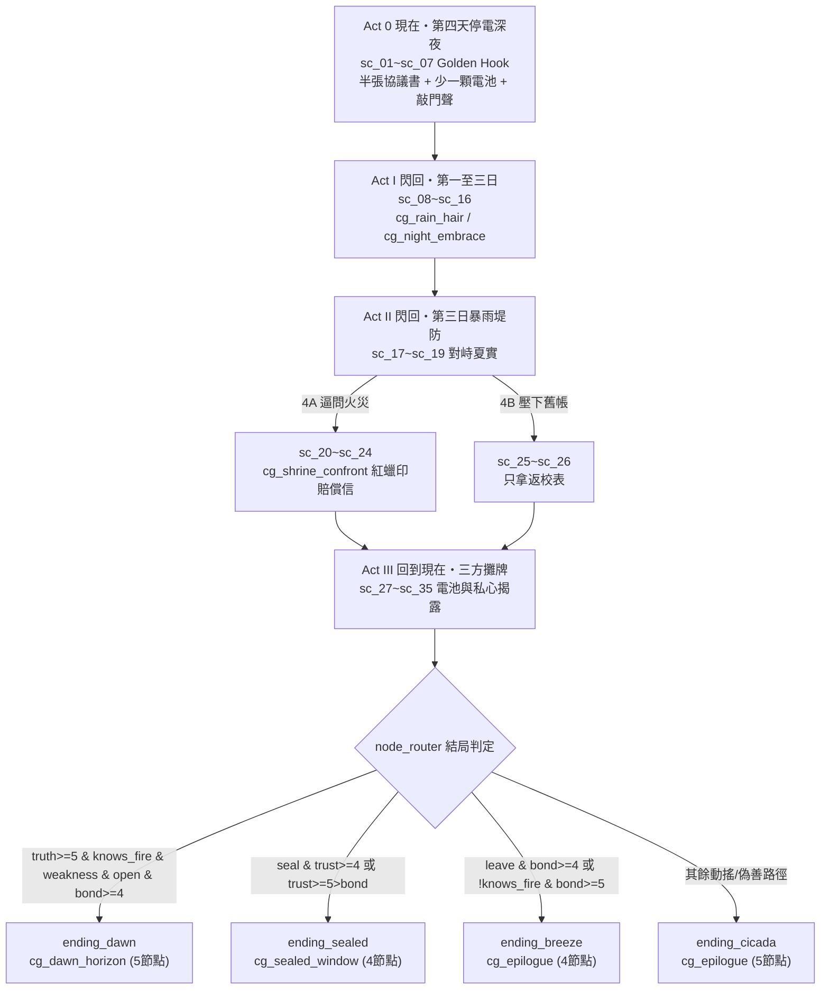

# 《夏末蟬鳴的彼岸》（Beyond the Summer Cicadas）— 敘事設計與分支腳本規格書（v3.0 StoryScope 版）

> **文件版本**：`v3.0`（依據工作室 `v1.4.0` `narrative-designer.md` 規範重構）  
> **文件定位**：供遊戲程式、美術、音效團隊對齊可執行節點資料之唯一敘事契約。  
> **分級與尺度**：全齡向／PG-13 心理懸疑情感視覺小說（聚焦共依存控制、逃避現實之私心、十年前舊宅火災補償責任與各自執念）。  
> **規模與節奏**：全作 **60 個節點**（59 個劇情節點 ＋ 1 個終局分流節點 `node_router`），單輪實玩約 35–39 個節點（8–10 分鐘），每段台詞嚴格控制在 1–2 句。  
> **角色名稱說明**：延續 `GAME_SPEC.md`、`ART_SPEC.md` 與引擎 `script_data.js` 既有契約，固定使用 **小鳥遊 悠真（`yuma`）**、**小鳥遊 琴理（`kotori`）**、**宮代 夏實（`natsumi`）**。

---

## Part 1：Studio Audit 報告（舊版 `script_data.js` / `SCRIPT_SPEC.md` 審查摘要）

經逐行審查舊版 `script_data.js`（v2.0，71 節點）與舊版 `SCRIPT_SPEC.md`（105 節點），列出以下 6 項明確違反 `narrative-designer.md`（v1.4.0）之敘事與跨部門對齊缺失：

1. **線性平鋪時間線（違反 Anti-AI-Fiction #2: Break Linear Time）**
   - 舊版 `script_data.js` 嚴格按「第一日抵達（`sc_01~sc_14`）→ 第二日外出（`sc_15~sc_27`）→ 第三日收信夜談（`sc_28~sc_37`）→ 第四日河堤告白（`sc_40_d4~sc_49`）→ 第五日攤牌（`sc_52~node_router`）」順時序流水帳推進，缺乏倒敘懸疑與碎片記憶拼圖結構。
2. **開頭缺乏 Golden Hook（違反 Storytelling Craft #1）**
   - 舊版 `sc_01`–`sc_03` 前段全數耗費於「八月下旬悶熱、公車塵灰、紙箱東京清潔劑味、老婦人提菜籃回頭看」等平淡抵達鋪陳（Exposition Dump），前 30 秒沒有任何即時危機、矛盾物件或三方張力。
3. **Say / Explain Themes 說教收尾（違反 Anti-AI-Fiction #1: No Over-Explaining Themes）**
   - 舊版高潮與四個結局頻繁出現替玩家下結論的旁白說教：如 `sc_36_night`（「這座屋子就會變成兩具逃避全世界的溫柔牢籠」）、`sc_end_sealed_03`（「門栓扣緊之後，再也沒有外人能傷害你們；同時，也再也沒有明天能夠走進來」）、`sc_end_cicada_03`（「半途而廢的溫柔與逃避真相的懦弱……」），將所有潛台詞與餘韻說死。
4. **重複描寫立繪／CG 已可見之外貌與服裝廢話（違反 Anti-AI-Fiction #4: Zero Redundant Appearance Prose）**
   - 舊版 `sc_01`、`sc_02`、`sc_15`、`sc_24_rain`、`sc_35_night`、`sc_43_cg`、`sc_end_breeze_02`、`sc_end_dawn_02` 等節點反覆書寫「純白細肩帶連身裙」「銀白長髮」「泛紅的紫灰瞳眸」「棕色側馬尾」「含淚的琥珀眼瞳」「米白蕾絲領夏衫與深藍百褶裙」「深青和式作務衣」等玩家肉眼已能在畫面上看見的外貌資訊，擠壓動作與潛台詞篇幅。
5. **角色雙面性與道德灰度不足（違反 Storytelling Craft #2 & Anti-AI-Fiction #3）**
   - 舊版琴理偏向被動脆弱、悠真僅在後段口頭懺悔、夏實幾乎是單純贖罪的好人，缺乏各自具象的計算與私心（藏文件與拔電池、逃避東京現實且貪圖「不被超越／被唯一需要」、因十年前火災補償責任而急於送走兄妹以撫平罪惡感）。
6. **缺少 `OUTFIT` 標籤與 `Required Assets Checklist`（違反 Cross-Department Asset Sync）**
   - 舊版 `SCRIPT_SPEC.md` 的 `[CHAR:]` 標籤缺少 `OUTFIT:` 欄位，開頭無 `Required Assets Checklist`，且僅列 5 張背景／CG（遺漏 `script_data.js` 實際使用的 5 張事件 CG），導致腳本與美術資產不同步。

---

## Part 2：Required Assets Checklist（跨部門資產總表）

本版腳本嚴格對齊既有已完稿精修資產，僅於「停電暴雨夜佛壇抽屜開場」因既有 `bg_nightroom.png` 畫面存在**點亮之電檯燈與晴朗月夜**（若直接沿用會產生嚴重停電時間穿幫），而增列 **1 項 `[NEW]` 必要背景**；其餘背景、立繪與 6 張 CG **全數沿用現有完成品**。

### 2.1 背景資產（`[BG: bg_id]`）

| Asset ID | 狀態 | 對應檔案／規格說明 |
| :--- | :--- | :--- |
| `bg_nightroom_blackout` | **`[NEW]`** | **唯一新增必要背景**（`1600×900` 16:9 RGB PNG，日系賽璐璐動畫風，無人物無文字）。**視覺規格**：停電暴雨夜的昏暗和室一角，和紙檯燈**完全熄滅**，障子窗外為濃重暴雨烏雲夜色；靠牆木造佛壇最底層抽屜半拉開，地面散落幾張舊紙角，僅有一道微弱暖黃手電筒光束斜照在榻榻米與抽屜邊緣。<br>*引擎過渡 fallback*：在新圖產出前，程式可暫以 `bg_nightroom` 疊加暗化遮罩（`brightness(0.42) contrast(1.15)`）模擬停電，完稿後直接替換 `assets/bg_nightroom_blackout.png`。 |
| `bg_oldhouse` | 沿用現有 | `assets/bg_oldhouse.png`（午後木造老宅緣廊、庭院與風鈴） |
| `bg_embankment` | 沿用現有 | `assets/bg_embankment.png`（黃昏河川堤防、水泥拱橋與芒草） |
| `bg_shrine` | 沿用現有 | `assets/bg_shrine.png`（林蔭斑駁光影中的宮代神社朱紅鳥居與石階） |
| `bg_nightroom` | 沿用現有 | `assets/bg_nightroom.png`（夜晚點亮和紙檯燈與月光映照的榻榻米和室） |

### 2.2 事件與結局 CG（`[CG: cg_id]`）— 6 張全數沿用現有

| CG ID | 狀態 | 對應檔案與劇情觸發節點 |
| :--- | :--- | :--- |
| `cg_rain_hair` | 沿用現有 | `assets/cg_rain_hair.png`（閃回 Act I `sc_09`–`sc_11b`：驟雨午後擦拭濕髮的試探） |
| `cg_night_embrace` | 沿用現有 | `assets/cg_night_embrace.png`（閃回 Act I `sc_14`–`sc_15b`：深夜圓窗月光下的戳破與依偎） |
| `cg_shrine_confront` | 沿用現有 | `assets/cg_shrine_confront.png`（閃回 Act II `sc_20`–`sc_24`：暴雨神社簷下，夏實捧著紅蠟印舊賠償信函坦白十年前火災） |
| `cg_sealed_window` | 沿用現有 | `assets/cg_sealed_window.png`（結局 `ending_sealed` `sc_end_sealed_03`–`04`：門栓落鎖後的封閉餘暉） |
| `cg_dawn_horizon` | 沿用現有 | `assets/cg_dawn_horizon.png`（結局 `ending_dawn` `sc_end_dawn_03`–`05`：清晨敞開緣廊、風鈴與晨光） |
| `cg_epilogue` | 沿用現有 | `assets/cg_epilogue.png`（結局 `ending_breeze` `sc_end_breeze_04` 與 `ending_cicada` `sc_end_cicada_05`：空無一人的清晨緣廊與群山遠景） |

### 2.3 角色立繪與服裝狀態（`[CHAR: char_id | OUTFIT: outfit_id | EXPR: expr_id | POS: pos]`）— 全數沿用現有

| 角色 ID | 角色名稱 | `OUTFIT` ID | 允許 `EXPR` ID | 允許 `POS` | 狀態 |
| :--- | :--- | :--- | :--- | :--- | :--- |
| `kotori` | 小鳥遊 琴理 | `white_sundress` | `idle`, `smile`, `sad`, `tense` | `left`, `center`, `right` | 沿用現有（`assets/char_kotori_*.png`） |
| `natsumi` | 宮代 夏實 | `summer_casual` | `idle`, `smile`, `sad`, `serious` | `left`, `center`, `right` | 沿用現有（`assets/char_natsumi_*.png`） |
| `none` | 清空場上立繪 | `—` | `—` | `—` | 系統指令 |

### 2.4 音訊曲目與音效（`[BGM: track_id]` / `[SFX: sfx_id]`）— 全數沿用 `AUDIO_SPEC.md`

- **BGM**：`title_breeze`、`summer_day`、`twilight_memory`、`tension_secret`、`climax_choice`
- **SFX**：`cicada_ambience`、`wind_chime`、`choice_confirm`、`heartbeat`、`door_slide`、`memory_flash`

---

## 3. 角色雙面性與聲線定調（Character Duality & Voice）

| 角色 | 表面人設（Surface Persona） | 隱藏私心／秘密（Hidden Flaw & Secret） | 說話聲線與小動作（Voice & Tic） |
| :--- | :--- | :--- | :--- |
| **小鳥遊 悠真 (`yuma`)** | 冷靜扛起責任、為了照顧妹妹才暫緩轉學的兄長。 | 在東京經歷父母離異與變故後的挫折與同儕落差，讓他極度逃避返校；照顧琴理一部分出於不想被任何人超越、想成為「某個人唯一必需品」的私心。他害怕的不是琴理受傷，而是琴理真的不需要他。 | 獨白精短克制，習慣透過觀察物體溫度、門鎖、時間差來替自己的退縮找合理藉口；被戳破時會先陷入停頓或轉移焦點。 |
| **小鳥遊 琴理 (`kotori`)** | 畏光怕生、離不開哥哥、聽見村人流言會發抖的脆弱妹妹。 | 早就悄悄把父親寄來的轉校與撫養權協議書撕毀一半藏進佛壇抽屜，並刻意將夏實留下的手電筒拆掉一顆電池——看似無助依賴，實則精準用「脆弱」與孤立環境把悠真鎖在舊屋。 | 語氣輕緩、多用看似商量的反問句或未說完的半句，逼對方主動把退路封死；說謊或算計時語調反而異常平穩。 |
| **宮代 夏實 (`natsumi`)** | 熱心爽朗的鄰居兼神社女兒，忙著送麥茶、公車表與聯絡校方。 | 急著幫悠真辦好返校與聯繫親戚，一半出於善意，另一半是因為十年前老屋偏廂那場火災與宮代家的補償責任——她迫切想把小鳥遊兄妹「安全送回正軌」，好撫平自己背了十年的罪惡感。 | 說話俐落務實、像在核對待辦清單；一被問及十年前火災或看到紅蠟印封套時語速會卡頓、下意識避開視線或捏緊手指。 |

---

## 4. 變數系統、相容映射與結局分流規則

### 4.1 狀態架構（`createInitialGameState`）

```json
{
  "trust": 1,
  "bond": 0,
  "truth": 0,
  "flag_hid_papers": false,
  "flag_knows_fire": false,
  "flag_admitted_weakness": false,
  "flag_final_choice": null
}
```

- **數值下限防護**：`applyEffects` 加減後若 `trust < 0` 或 `bond < 0` 或 `truth < 0`，一律下限鉗制為 `0`（`Math.max(0, val)`）。
- **既有程式碼相容映射表（供 `script_data.js` / `game.js` 同步對接）**：
  - `trust` ↔ 舊版 `dependency`（代表兄妹封閉依存／私密共犯信任）
  - `bond` ↔ 舊版 `outsideBond`（代表外界連結與夏實羈絆）
  - `truth` ↔ 舊版 `truth`（代表十年前火災與自我私心之直面程度）
  - 心境波動 `resonance` 映射：`trust` 主導時回傳 `'dependency'`（或 `'trust'`）；`bond` 主導時回傳 `'outsideBond'`（或 `'bond'`）；`truth` 主導時回傳 `'truth'`。

### 4.2 五次兩難抉擇與四結局路徑總表

| 選擇點 | 節點 | 選項設計與代價（無零成本選項） | 數值與旗標影響 |
| :--- | :--- | :--- | :--- |
| **抉擇 1** | `sc_03` | **A**：將撕毀的協議書塞回抽屜、去替琴理應門<br>**B**：借手電筒餘光當面追問協議書的由來<br>**C**：不先對質，越過琴理直接打開玄關放夏實進來 | **A**：`trust +2, bond -1, flag_hid_papers: true`<br>**B**：`truth +2, trust -1`<br>**C**：`bond +2, truth +1` |
| **抉擇 2** | `sc_10` | **A**：關掉手機靜音，承認這幾天不需要接東京電話<br>**B**：堅持該接的電話還是得接，拉開保護與滯留的界線 | **A**：`trust +2, bond -1`<br>**B**：`bond +2, trust -1` |
| **抉擇 3** | `sc_14` | **A**：默認琴理的話、收緊手指守住「只剩彼此」的藉口<br>**B**：承認留下來有一半是為了逃避東京的失敗與孤獨 | **A**：`trust +2, truth -1`<br>**B**：`truth +2, bond +1, flag_admitted_weakness: true` |
| **抉擇 4** | `sc_19` | **A**：逼問夏實十年前偏廂起火那晚宮代家的作為（解鎖 `cg_shrine_confront`）<br>**B**：壓下過去不追問，只拿走復學與連絡手續清單 | **A**：`truth +2, bond +1, flag_knows_fire: true`<br>**B**：`bond +2, truth -1` |
| **抉擇 5** | `sc_33` | **A**：關門將夏實留在雨夜外，轉身插上雨戶門栓<br>**B**：拎起書包與手電筒走向門外，不等沒準備好的琴理<br>**C**：當面承認自己的懦弱與私心，將去留的決定權交還給琴理 | **A**：`trust +2, bond -2, flag_final_choice: 'seal'`<br>**B**：`bond +2, trust -2, flag_final_choice: 'leave'`<br>**C**：`truth +2, bond +1, flag_final_choice: 'open'` |

### 4.3 `node_router` 結局判定優先序（互斥窮盡）

1. **`ending_dawn`（True End — `cg_dawn_horizon`）**：  
   `flag_knows_fire === true && flag_admitted_weakness === true && flag_final_choice === 'open' && bond >= 4 && trust <= 3`
2. **`ending_sealed`（Closed End — `cg_sealed_window`）**：  
   `(flag_final_choice === 'seal' && trust >= 4) || (trust >= 5 && trust > bond)`
3. **`ending_breeze`（Normal End — `cg_epilogue`）**：  
   `(flag_final_choice === 'leave' && bond >= 4) || (!flag_knows_fire && bond >= 5 && bond > trust)`
4. **`ending_cicada`（Bitter End — `cg_epilogue`）**：  
   `ELSE`（猶疑動搖、知情卻不坦白軟弱、或未查明火災卻想強行開門導致信任碎裂）

### 4.4 非線性時間軸結構圖



---

## 5. 完整可遊玩分支腳本（60 節點）

> **格式約定**：台詞標註為 `旁白`（悠真內心視角）、`悠真`、`琴理`、`夏實`；每行限 1–2 句，禁止任何外貌／服裝重複描寫與說教結語。

---

### 【Act 0：現在・第四天深夜・停電之後】（`sc_01` ~ `sc_07`）

#### `sc_01`
* `sceneTitle`: `現在・停電後的佛壇前`
* `[BG: bg_nightroom_blackout]`
* `[CHAR: none]`
* `[BGM: tension_secret]`
* `[SFX: heartbeat]`
* **旁白**：暴雨切斷村裡輸電線已經過了十分鐘。手電筒的光柱突然暗了一半，搖開背蓋一摸——裡面只剩一顆電池。
* **旁白**：就著快熄滅的微光，我從佛壇最底層抽屜的線香盒底下，摸出半張被整齊撕開的《轉校與撫養權協議書》。
* **旁白**：屋裡傳來赤腳踩過冷木地板的黏滯聲；同一秒，玄關竹門外響起急促卻刻意壓低的叩門聲。
* `next: sc_02`

#### `sc_02`
* `sceneTitle`: `現在・停電後的佛壇前`
* `[SFX: door_slide]`
* `[CHAR: kotori | OUTFIT: white_sundress | EXPR: tense | POS: center]`
* **旁白**：紙門無聲滑開半幅。琴理站在光圈邊緣，視線沒看我的臉，直接落在那半張起毛邊的協議書與接觸不良的手電筒上。
* **琴理**：那支手電筒本來就壞了，悠真。別再按了，會傷手。
* **琴理**：……外頭在拍門的，是夏實對吧。
* `next: sc_03`

#### `sc_03`
* `sceneTitle`: `現在・停電後的佛壇前`
* `[CHAR: kotori | OUTFIT: white_sundress | EXPR: sad | POS: center]`
* **旁白**：叩門聲又響了三下，這回混著雨傘滴水的啪嗒聲。琴理微微側過半步，剛好把通往玄關的走道擋住一半。
* `choices`:
  1. `{ label: "把協議書塞回抽屜，起身去玄關打發夏實：「停電而已，我們不需要誰進來。」", effects: { trust: 2, bond: -1, flag_hid_papers: true }, resonance: "dependency", next: "sc_04a" }`
  2. `{ label: "把半張紙舉到微光裡：「姑姑簽好字的文件……妳早就看過了，對吧？」", effects: { truth: 2, trust: -1 }, resonance: "truth", next: "sc_04b" }`
  3. `{ label: "不先拆穿她，側身繞過走道拉開玄關門：「屋裡太暗了，先讓夏實進來。」", effects: { bond: 2, truth: 1 }, resonance: "outsideBond", next: "sc_04c" }`

#### `sc_04a`
* `sceneTitle`: `現在・停電後的佛壇前`
* `[CHAR: kotori | OUTFIT: white_sundress | EXPR: smile | POS: center]`
* **旁白**：紙張重新滑回線香盒底，木抽屜合上時發出輕微的卡榫聲。琴理的肩膀這才一點一點鬆下來。
* **琴理**：嗯……我也覺得，門外有雨的時候還是關著比較好。
* `next: sc_05`

#### `sc_04b`
* `sceneTitle`: `現在・停電後的佛壇前`
* `[CHAR: kotori | OUTFIT: white_sundress | EXPR: tense | POS: center]`
* **旁白**：琴理沒有伸手來搶，只是把指尖緩緩收進背後。手電筒的光閃了一下，她連睫毛都沒眨。
* **琴理**：撕掉另一半的人又不只我一個，悠真。姑姑打電話來的那天晚上，掛掉電話的人是你吧。
* `next: sc_05`

#### `sc_04c`
* `sceneTitle`: `現在・停電後的佛壇前`
* `[SFX: door_slide]`
* `[CHAR: kotori | OUTFIT: white_sundress | EXPR: tense | POS: left]`
* **旁白**：我越過琴理身旁去撥玄關木栓。手背擦過她臂側時，她整條手臂硬得像塊浸過冰水的木頭。
* **琴理**：……悠真現在連屋裡停電，都要先找外人進來嗎？
* `next: sc_05`

#### `sc_05`
* `sceneTitle`: `現在・停電後的佛壇前`
* `[CHAR: kotori | OUTFIT: white_sundress | EXPR: idle | POS: left]`
* `[CHAR: natsumi | OUTFIT: summer_casual | EXPR: serious | POS: right]`
* **旁白**：門縫拉開一掌寬，潮濕的風立刻灌進來。夏實手裡捏著一排沒拆封的電池和一張摺得發皺的車次表，胸口急促起伏。
* **夏實**：還好屋裡沒事……剛才村尾變電箱跳掉，我怕你們留著的那支舊手電筒不夠用。
* **夏實**：還有，鎮公所剛才打電話到神社問，明天九點再不把監護與轉學文件補齊，東京那邊的遠房親戚就會直接派人來接琴理——
* `next: sc_06`

#### `sc_06`
* `sceneTitle`: `現在・停電後的佛壇前`
* `[CHAR: kotori | OUTFIT: white_sundress | EXPR: tense | POS: left]`
* `[CHAR: natsumi | OUTFIT: summer_casual | EXPR: sad | POS: right]`
* **旁白**：夏實的視線忽然停在和室深處——半開的佛壇抽屜旁，露出一截沒關嚴的木箱焦痕。她握著電池的手指猛地收緊，指節發白。
* **夏實**：……你們翻過老屋偏廂留下的箱子了？
* **悠真**：夏實，這排電池是妳前天拿來的吧。既然本來裝滿兩顆——另外一顆去哪了？
* `next: sc_07`

#### `sc_07`
* `sceneTitle`: `現在・停電後的佛壇前`
* `[SFX: memory_flash]`
* `[CHAR: kotori | OUTFIT: white_sundress | EXPR: sad | POS: left]`
* `[CHAR: natsumi | OUTFIT: summer_casual | EXPR: serious | POS: right]`
* **旁白**：黑暗裡三個人的呼吸同時停了半秒。夏實袖口沾著淡淡的神社線香與舊木屑味，琴理卻悄無聲息地往我身後貼近半寸，像第一天踏進這棟屋子時那樣。
* **旁白**：那股熟悉的壓迫感猛地撞回腦海——四天前我們搬進來時，這一切究竟是誰先動的手？
* `next: sc_08`

---

### 【Act I：閃回・第一日至第三日深夜（鎖與脆弱）】（`sc_08` ~ `sc_16`）

#### `sc_08`
* `sceneTitle`: `閃回・第一日午後的木栓`
* `[BG: bg_oldhouse]`
* `[BGM: summer_day]`
* `[SFX: cicada_ambience]`
* `[CHAR: kotori | OUTFIT: white_sundress | EXPR: idle | POS: center]`
* **旁白**：四天前剛踏進這棟空了三年的木宅時，琴理並沒有先拆行李，而是順著緣廊把朝向鄰家的木製雨戶一格格插上門栓。
* **琴理**：巷口的阿姨一直往院子裡看。先把裡面關起來好不好，悠真？
* **旁白**：我沒有阻止她。在東京被同學用同情眼神盯著、被律師當成未成年的拖油瓶那天起，只有在她說「這屋子只能靠你」的時候，我才覺得自己沒有輸給任何人。
* `next: sc_09`

#### `sc_09`
* `sceneTitle`: `閃回・第二日驟雨的毛巾`
* `[CG: cg_rain_hair]`
* `[BGM: twilight_memory]`
* `[SFX: door_slide]`
* **旁白**：第二天午後驟雨砸上屋簷，外頭拉起一片藍灰水霧。我跪坐在榻榻米上替剛淋濕進門的琴理按乾髮尾，小檯燈把我們之間照得過分安靜。
* **琴理**：外頭的雷聲好吵……毛巾貼著耳朵的時候，就聽不見那麼清楚了。
* `next: sc_10`

#### `sc_10`
* `sceneTitle`: `閃回・第二日驟雨的毛巾`
* `[CG: cg_rain_hair]`
* `[SFX: heartbeat]`
* **旁白**：琴理把毛巾的另一角捏進指縫裡，指腹正好隔著棉布輕輕壓住我的手腕。
* **琴理**：吶，悠真……剛才你去買東西的時候，玄關那支舊手機一直在震動，顯示的是東京姑姑的號碼。要是明天她又打來，你會接嗎？
* `choices`:
  1. `{ label: "「我等一下就去把手機關靜音。至少這幾天，誰都不要打擾我們。」", effects: { trust: 2, bond: -1 }, resonance: "dependency", next: "sc_11a" }`
  2. `{ label: "「該回的電話還是得回。我陪妳留在這兒，不是為了讓兩個人都躲一輩子。」", effects: { bond: 2, trust: -1 }, resonance: "outsideBond", next: "sc_11b" }`

#### `sc_11a`
* `sceneTitle`: `閃回・第二日驟雨的毛巾`
* `[CG: cg_rain_hair]`
* **旁白**：琴理指尖的力道鬆開，順勢把額頭靠進我掌心旁的毛巾摺痕裡，嘴角彎起一個讓人卸下戒心的弧度。
* **琴理**：嗯……只要你不點頭，外頭的人就拿我們沒辦法。
* `next: sc_12`

#### `sc_11b`
* `sceneTitle`: `閃回・第二日驟雨的毛巾`
* `[CG: cg_rain_hair]`
* **旁白**：我抽出手把毛巾放回她膝上，往後退開半個坐墊。琴理低頭盯著被抽走的空處，安靜得連雨聲都顯得刺耳。
* **琴理**：……原來連悠真，也開始算著什麼時候要走了嗎。
* `next: sc_12`

#### `sc_12`
* `sceneTitle`: `閃回・第二日傍晚的訪客`
* `[BG: bg_oldhouse]`
* `[BGM: summer_day]`
* `[SFX: wind_chime]`
* `[CHAR: natsumi | OUTFIT: summer_casual | EXPR: smile | POS: center]`
* **旁白**：雨勢剛歇，夏實推著腳踏車停在竹門外，遞來一袋冰鎮麥茶與一支全新的手電筒——我親眼看著她推開開關試光，燈泡亮得刺眼。
* **夏實**：九月一日之前，轉學報到跟親戚那邊的連絡單都得交出去。我明天一早陪你去鎮公所吧，拖越久對你們越不利。
* `next: sc_13`

#### `sc_13`
* `sceneTitle`: `閃回・第二日傍晚的訪客`
* `[CHAR: natsumi | OUTFIT: summer_casual | EXPR: serious | POS: center]`
* **旁白**：她話說得極快，像在趕一份非完成不可的工期。可當目光掃過緣廊盡頭那根被深色油漆重新刷蓋過的舊木柱時，夏實的笑臉忽然頓住。
* **夏實**：……這棟老屋偏廂十年前燒過一次，木樑潮氣重，真的不適合你們一直關在裡面。明天早上我在堤防等你們，一定要出來喔。
* `next: sc_14`

#### `sc_14`
* `sceneTitle`: `閃回・第三日深夜的圓窗`
* `[CG: cg_night_embrace]`
* `[BGM: tension_secret]`
* `[SFX: heartbeat]`
* **旁白**：第三天凌晨兩點，月光從圓形木格窗漏進來。我原本以為琴理已經睡熟，卻被一隻冰涼的手輕輕按住膝蓋。
* **琴理**：悠真……你在東京的時候，每次模擬考被同班同學比下去、回家看見空蕩蕩的餐桌，是不是都覺得只有我還等著你，才像個哥哥？
* **琴理**：你並不是真的放不下我吧。你只是害怕一旦不需要照顧我，就再也沒有人非要你不可了。
* `choices`:
  1. `{ label: "收緊手掌壓住她的手背：「別亂說……我們之間不需要去算這些，只剩彼此有什麼不好？」", effects: { trust: 2, truth: -1 }, resonance: "dependency", next: "sc_15a" }`
  2. `{ label: "沒有抽開膝上的手，低聲承認：「……妳說對了。我躲進這裡，有一半是為了我自己。」", effects: { truth: 2, bond: 1, flag_admitted_weakness: true }, resonance: "truth", next: "sc_15b" }`

#### `sc_15a`
* `sceneTitle`: `閃回・第三日深夜的圓窗`
* `[CG: cg_night_embrace]`
* **旁白**：我沒有回答她的後半句，只把她冰冷的手指包進掌心。琴理偏過頭把臉貼上我的肩胛，呼吸輕得像一聲得逞的嘆息。
* **琴理**：……那就好。只要你也承認離不開這裡，明天我什麼都不怕了。
* `next: sc_16`

#### `sc_15b`
* `sceneTitle`: `閃回・第三日深夜的圓窗`
* `[CG: cg_night_embrace]`
* **旁白**：說出口的瞬間，連我自己都覺得脊椎一涼。琴理靠在肩上的身體明顯僵了一下，搭在膝頭的五指慢慢蜷緊。
* **琴理**：……好誠實啊，悠真。可是如果連你都只是在逃跑，那我抓著的這隻手，算什麼呢？
* `next: sc_16`

#### `sc_16`
* `sceneTitle`: `閃回・第三日深夜的圓窗`
* `[BG: bg_nightroom]`
* `[SFX: memory_flash]`
* `[CHAR: none]`
* **旁白**：那一晚我們都沒再閉眼。天色剛亮，我踩著雨前的悶熱獨自出門——口袋裡塞著從舊柱腳邊撿到的一角燒焦和紙，還有夏實催得太急的疑惑。
* `next: sc_17`

---

### 【Act II：閃回・第三日暴雨堤防與神社（十年前的火）】（`sc_17` ~ `sc_26`）

#### `sc_17`
* `sceneTitle`: `閃回・堤防的舊帳`
* `[BG: bg_embankment]`
* `[BGM: twilight_memory]`
* `[CHAR: natsumi | OUTFIT: summer_casual | EXPR: idle | POS: center]`
* **旁白**：傍晚的積雨雲壓在河橋上方。夏實站在堤防石階口，手裡已經把填好一半的轉校聯絡單和親戚電話抄好了。
* **夏實**：你總算肯單獨出來了。這是學校跟鎮公所的聯絡窗口，只要明天上午簽完名——
* `next: sc_18`

#### `sc_18`
* `sceneTitle`: `閃回・堤防的舊帳`
* `[CHAR: natsumi | OUTFIT: summer_casual | EXPR: serious | POS: center]`
* **旁白**：我沒接那張紙，只是把從老屋牆角撿來、邊緣焦黑發脆的神社舊紙符角放在她掌心上。夏實像被燙到一樣猛地縮回手，紙片掉在芒草間。
* **悠真**：別再拿時間表催我了。妳這麼急著把我們送回東京親戚家，到底是因為擔心我們……還是只要我們不在這裡，妳就不用每天經過那棟燒過的房子？
* `next: sc_19`

#### `sc_19`
* `sceneTitle`: `閃回・堤防的舊帳`
* `[CHAR: natsumi | OUTFIT: summer_casual | EXPR: sad | POS: center]`
* **旁白**：第一滴雨砸在混凝土橋墩上。夏實盯著地上那角焦紙，嘴唇動了兩次卻沒發出聲音。
* `choices`:
  1. `{ label: "「十年前偏廂起火那晚，宮代家的人到底在現場做了什麼？全部告訴我。」", effects: { truth: 2, bond: 1, flag_knows_fire: true }, resonance: "truth", next: "sc_20" }`
  2. `{ label: "彎腰撿起聯絡單拍掉灰塵：「……算了，過去的別翻了。明天怎麼辦手續，妳直接說吧。」", effects: { bond: 2, truth: -1 }, resonance: "outsideBond", next: "sc_25" }`

#### `sc_20`
* `sceneTitle`: `閃回・暴雨簷下的贖罪`
* `[CG: cg_shrine_confront]`
* `[BGM: climax_choice]`
* `[SFX: heartbeat]`
* **旁白**：暴雨傾瀉而下，兩人衝進神社偏殿屋簷底下。夏實沒有擦臉上的雨水，只是從懷裡掏出一封綴著紅蠟印、卻始終沒送出去的舊信封，雙手死死按在胸口。
* **夏實**：十年前夏祭前夜……我外公派人把祭典用剩的燈油桶暫放在你們家老宅偏廂的竹棚邊，是我拿線香去試著點亮舊提燈，才會把火星濺到油桶上！
* `next: sc_21`

#### `sc_21`
* `sceneTitle`: `閃回・暴雨簷下的贖罪`
* `[CG: cg_shrine_confront]`
* `[SFX: memory_flash]`
* **旁白**：記憶裡驟然翻起刺鼻的濃煙與木樑斷裂的脆響——難怪母親離村後每逢陰雨就咳得喘不過氣，難怪父親臨走前跟村裡徹底決裂。
* **夏實**：偏廂燒塌那天夜裡，是宮代家拿出一筆賠償金私下跟你們外公壓住報案紀錄。大人們要我這輩子不准再提，我外公連房子都幫忙重新上漆蓋掉焦痕——
* `next: sc_22`

#### `sc_22`
* `sceneTitle`: `閃回・暴雨簷下的贖罪`
* `[CG: cg_shrine_confront]`
* **旁白**：夏實的肩膀抖得厲害，指尖把那枚紅蠟印捏得變了形。
* **夏實**：父母出事之後你們突然回來住進那棟屋子，我每天都像看見十年前的火又燒起來一樣！我拼命催你們轉學、幫你們聯絡東京的姑姑、送茶送手電筒——
* `next: sc_23`

#### `sc_23`
* `sceneTitle`: `閃回・暴雨簷下的贖罪`
* `[CG: cg_shrine_confront]`
* **夏實**：我以為只要把你們兄妹「安全送回正軌」，我欠你們家的債就算還清了……其實我只是自私地想把你們送離我的視線，好讓我自己睡得著覺而已！
* `next: sc_24`

#### `sc_24`
* `sceneTitle`: `閃回・暴雨簷下的贖罪`
* `[CG: cg_shrine_confront]`
* **旁白**：她把那封紅蠟印信遞到我面前，眼底沒有半點平時那種居高臨下的熱心，只剩狼狽。我接過信封時，手裡比剛才在堤防上還重。
* `next: sc_27`

#### `sc_25`
* `sceneTitle`: `閃回・未拆的信封`
* `[BG: bg_shrine]`
* `[SFX: wind_chime]`
* `[CHAR: natsumi | OUTFIT: summer_casual | EXPR: sad | POS: center]`
* **旁白**：夏實愣在原地看著我彎腰撿起聯絡單。她原本按在胸前口袋的手悄悄鬆開，像把什麼沉重的東西又塞回了深處。
* **夏實**：……對不起，悠真。謝謝你沒有追問下去。
* `next: sc_26`

#### `sc_26`
* `sceneTitle`: `閃回・未拆的信封`
* `[CHAR: natsumi | OUTFIT: summer_casual | EXPR: idle | POS: center]`
* **旁白**：屋簷上方的玻璃風鈴被濕風撞響。夏實把時刻表交到我手裡時，我看見她肩頭明顯鬆了一口氣——那是連她自己都沒察覺的僥倖。
* **旁白**：那天晚上我提著兩包雜貨走回老宅，沒過多久，全村便在大暴雨裡斷了電。
* `next: sc_27`

---

### 【Act III：回到現在・第四天深夜三方攤牌】（`sc_27` ~ `sc_35`）

#### `sc_27`
* `sceneTitle`: `現在・三方對峙`
* `[BG: bg_nightroom_blackout]`
* `[BGM: tension_secret]`
* `[SFX: heartbeat]`
* `[CHAR: kotori | OUTFIT: white_sundress | EXPR: tense | POS: left]`
* `[CHAR: natsumi | OUTFIT: summer_casual | EXPR: serious | POS: right]`
* **旁白**：記憶與雨夜重新重合。手電筒的最後一絲餘光閃了兩下徹底熄滅，門廊陷入只剩窗外雨氣的暗影裡。
* **旁白**：我低頭看著手裡的協議書碎片，再抬眼看面前這兩個人——沒有一個人是無辜的。
* `next: sc_28`

#### `sc_28`
* `sceneTitle`: `現在・三方對峙`
* `[CHAR: kotori | OUTFIT: white_sundress | EXPR: idle | POS: left]`
* `[CHAR: natsumi | OUTFIT: summer_casual | EXPR: serious | POS: right]`
* **悠真**：手電筒的另一顆電池，從昨晚就躺在妳的衣袋裡吧，琴理。
* **旁白**：琴理沒有急著否認，只是輕輕把手伸進口袋摸了一下，發出極微弱的金屬輕碰聲。
* **琴理**：如果屋裡沒有燈，外頭又停電，悠真就只能待在房間裡陪我等天亮……這樣不對嗎？
* `next: sc_29`

#### `sc_29`
* `sceneTitle`: `現在・三方對峙`
* `[CHAR: kotori | OUTFIT: white_sundress | EXPR: sad | POS: left]`
* `[CHAR: natsumi | OUTFIT: summer_casual | EXPR: sad | POS: right]`
* **夏實**：琴理，妳把文件撕掉又拆掉電池，只會把悠真一起拖進這個死胡同——
* **琴理**：那夏實妳呢？從第一天開始就不停送麥茶、送聯絡單、急著替我們聯絡東京的親戚……妳真的只是怕我們沒書唸嗎？
* `next: sc_30`

#### `sc_30`
* `sceneTitle`: `現在・三方對峙`
* `[CHAR: kotori | OUTFIT: white_sundress | EXPR: tense | POS: left]`
* `[CHAR: natsumi | OUTFIT: summer_casual | EXPR: sad | POS: right]`
* **旁白**：夏實的呼吸一窒，下意識抓住玄關門框。
* `[IF flag_knows_fire == true]` **悠真**：十年前這棟屋子燒掉偏廂的那場火，夏實剛才已經在神社告訴我了。琴理，她急著送走我們，是因為看見我們就會想起宮代家的債。
* `[ELSE]` **悠真**：別吵了。這裡沒有誰是真的毫無私心——包括我自己。
* `next: sc_31`

#### `sc_31`
* `sceneTitle`: `現在・三方對峙`
* `[CHAR: kotori | OUTFIT: white_sundress | EXPR: sad | POS: left]`
* `[CHAR: natsumi | OUTFIT: summer_casual | EXPR: serious | POS: right]`
* `[IF flag_knows_fire == true]` **夏實**：……是啊，我就是想把你們安全送回學校，好讓我自己這十年的罪惡感有地方放。就算這樣，總比兩個人關在沒有光的屋子裡好吧！
* `[ELSE]` **夏實**：……我只是想讓事情回到正軌而已。悠真，明天九點之前，你到底要不要出門？
* `next: sc_32`

#### `sc_32`
* `sceneTitle`: `現在・三方對峙`
* `[BGM: climax_choice]`
* `[CHAR: kotori | OUTFIT: white_sundress | EXPR: tense | POS: left]`
* `[CHAR: natsumi | OUTFIT: summer_casual | EXPR: serious | POS: right]`
* **旁白**：協議書的撕角還在指縫裡發皺。琴理盯著我沒移開半寸，夏實捏著新電池的手停在半空。
* **琴理**：悠真……你今天只要踏出玄關一步，明天就輪到姑姑來接我了。你要我跟你一起出去，還是要我留著？
* `next: sc_33`

#### `sc_33`
* `sceneTitle`: `現在・三方對峙`
* `[CHAR: kotori | OUTFIT: white_sundress | EXPR: sad | POS: left]`
* `[CHAR: natsumi | OUTFIT: summer_casual | EXPR: serious | POS: right]`
* **旁白**：房間暗得看不清兩人的表情，只剩雨滴從屋簷砸進水窪的節拍。
* `choices`:
  1. `{ label: "把夏實推回門廊外，拉上木門插死門栓：「外面的善意我們背不起。琴理，不用管九月了。」", effects: { trust: 2, bond: -2, flag_final_choice: "seal" }, resonance: "dependency", next: "sc_34a" }`
  2. `{ label: "接過夏實手裡的電池與聯絡單：「我明天去報到。如果妳不肯跨過門檻，那我先走。」", effects: { bond: 2, trust: -2, flag_final_choice: "leave" }, resonance: "outsideBond", next: "sc_34b" }`
  3. `{ label: "把協議書放上矮桌：「我留著妳是因為我自己怕輸、怕被拋下。明天我會出門——這一次我不替妳選，妳自己決定跟不跟上。」", effects: { truth: 2, bond: 1, flag_final_choice: "open" }, resonance: "truth", next: "sc_34c" }`

#### `sc_34a`
* `sceneTitle`: `現在・落栓之夜`
* `[SFX: door_slide]`
* `[CHAR: kotori | OUTFIT: white_sundress | EXPR: smile | POS: center]`
* **旁白**：木門合攏把夏實的呼喚切在外面，黃銅門栓「喀」地扣到底。琴理慢慢從口袋摸出那顆被她藏了一整天的電池，放進我手心。
* **琴理**：……現在可以不用看任何人的臉色了，悠真。
* `next: sc_35`

#### `sc_34b`
* `sceneTitle`: `現在・分道之夜`
* `[CHAR: kotori | OUTFIT: white_sundress | EXPR: sad | POS: left]`
* `[CHAR: natsumi | OUTFIT: summer_casual | EXPR: serious | POS: right]`
* **旁白**：夏實手裡的電池塞進我掌心，冰涼得像塊鐵。琴理往後退進暗處，沒有拉我的衣袖，只是輕輕點了點頭。
* **琴理**：嗯。原來只要先走的人是你，就不算背叛了呀。
* `next: sc_35`

#### `sc_34c`
* `sceneTitle`: `現在・坦白之後`
* `[CHAR: kotori | OUTFIT: white_sundress | EXPR: tense | POS: left]`
* `[CHAR: natsumi | OUTFIT: summer_casual | EXPR: sad | POS: right]`
* **旁白**：和室靜了整整五秒。夏實不知何時收起了原本急著遞過來的聯絡單，退到門檻外沒再催促；琴理盯著桌上那半張被我攤平的協議書，指尖微微發抖。
* **琴理**：……你把責任全部推回來給我，好狡猾啊，悠真。
* `next: sc_35`

#### `sc_35`
* `sceneTitle`: `現在・黎明前夕`
* `[CHAR: none]`
* `[SFX: cicada_ambience]`
* **旁白**：凌晨四點半，雨勢終於轉弱。走廊盡頭木窗的縫隙裡，滲進第一縷微冷的灰藍天光。
* `next: node_router`

---

### 【終局判定分流器】（`node_router`）

#### `node_router`
* `isRouter: true`
* **判定邏輯（依序檢查）**：
  1. `if (flag_knows_fire === true && flag_admitted_weakness === true && flag_final_choice === 'open' && bond >= 4 && trust <= 3)` -> `sc_end_dawn_01`
  2. `else if ((flag_final_choice === 'seal' && trust >= 4) || (trust >= 5 && trust > bond))` -> `sc_end_sealed_01`
  3. `else if ((flag_final_choice === 'leave' && bond >= 4) || (!flag_knows_fire && bond >= 5 && bond > trust))` -> `sc_end_breeze_01`
  4. `else` -> `sc_end_cicada_01`

---

### 【結局 C：`ending_dawn` — 真實破繭清晨】（`sc_end_dawn_01` ~ `sc_end_dawn_05`）

#### `sc_end_dawn_01`
* `sceneTitle`: `終章・雨歇的緣廊`
* `[BG: bg_oldhouse]`
* `[BGM: title_breeze]`
* `[SFX: door_slide]`
* `[CHAR: kotori | OUTFIT: white_sundress | EXPR: idle | POS: center]`
* **旁白**：五點十分，我把昨晚掉在桌角的玄關鑰匙放進書包。推開外側雨戶時，潮濕的杉木葉氣味瞬間灌滿走廊。
* **旁白**：琴理站在門檻邊停了兩秒，伸手把那枚還剩一格電的舊手電筒擺回佛壇抽屜，自己踩上帆布鞋。
* `next: sc_end_dawn_02`

#### `sc_end_dawn_02`
* `sceneTitle`: `終章・雨歇的緣廊`
* `[CHAR: kotori | OUTFIT: white_sundress | EXPR: sad | POS: center]`
* **琴理**：我還是沒辦法立刻喜歡東京的姑姑……也不想原諒那場火。
* **悠真**：沒人要妳原諒。先把轉學單交了，剩下的，妳想留在這兒或回東京，下週再自己決定。
* `next: sc_end_dawn_03`

#### `sc_end_dawn_03`
* `sceneTitle`: `終章・夏末彼岸的微光`
* `[CG: cg_dawn_horizon]`
* `[SFX: wind_chime]`
* **旁白**：晨風沿著緣廊吹散屋裡的悶氣，屋角的玻璃風鈴清脆地撞響一聲。琴理沒有伸手拉住我的袖口，只是看著東方剛翻亮的山脊線，眼眶微紅地輕輕吐出一口氣。
* **琴理**：……外頭的風，原來比房間裡還要吵啊。
* `next: sc_end_dawn_04`

#### `sc_end_dawn_04`
* `sceneTitle`: `終章・夏末彼岸的微光`
* `[BG: bg_shrine]`
* `[CHAR: kotori | OUTFIT: white_sundress | EXPR: idle | POS: left]`
* `[CHAR: natsumi | OUTFIT: summer_casual | EXPR: sad | POS: right]`
* **旁白**：經過神社石階口時，早早站在那兒的夏實看見並肩走過來的我們，手裡的掃帚差點滑脫。她沒有說「太好了」，只是把昨晚那封紅蠟印信伸過來。
* **夏實**：這封信……你們看過之後如果想丟掉，也沒關係。
* **琴理**：先留著吧。至少下次停電的時候，我們不會再連電池都少一顆了。
* `next: sc_end_dawn_05`

#### `sc_end_dawn_05`
* `sceneTitle`: `結局 C・夏末彼岸的微光`
* `[CG: cg_dawn_horizon]`
* `[BGM: title_breeze]`
* `[SFX: wind_chime]`
* `ending: ending_dawn`
* **旁白**：通往村口的碎石坡道上，琴理走快了兩步，鞋跟在石階上敲出兩道不再重疊的節拍。遠處公車進站的煞車聲穿過林梢傳來，而屋簷下的風鈴又輕輕晃了一下。

---

### 【結局 A：`ending_sealed` — 繭中之夏】（`sc_end_sealed_01` ~ `sc_end_sealed_04`）

#### `sc_end_sealed_01`
* `sceneTitle`: `結局 A・門栓之內`
* `[BG: bg_oldhouse]`
* `[BGM: tension_secret]`
* `[CHAR: none]`
* **旁白**：上午八點半，竹籬笆外傳來塑膠袋摩擦木柱的聲響，接著是夏實壓低嗓音喊了兩次我的名字。沒人回應，十幾分鐘後腳步聲踩著碎石走遠。
* **旁白**：我拔掉玄關門鈴的細電線，將最後一扇能看見馬路的木窗也插上插銷。
* `next: sc_end_sealed_02`

#### `sc_end_sealed_02`
* `sceneTitle`: `結局 A・門栓之內`
* `[CHAR: kotori | OUTFIT: white_sundress | EXPR: smile | POS: center]`
* **旁白**：桌上的舊鬧鐘在昨夜停電時卡在兩點十四分，我們誰也沒有去換電池。琴理替我倒了半杯已經涼透的麥茶，杯壁上的水珠滑在榻榻米上。
* **琴理**：門外頭的聲音，聽起來好像變得很遠很遠了呢。
* `next: sc_end_sealed_03`

#### `sc_end_sealed_03`
* `sceneTitle`: `結局 A・繭中之夏`
* `[CG: cg_sealed_window]`
* `[BGM: twilight_memory]`
* `[SFX: heartbeat]`
* **旁白**：緊閉的木格障子只透進一層暗淡的琥珀餘暉，塵埃在空氣裡幾乎靜止。琴理閉上眼睛將重量靠上我的右肩，呼吸平穩得像睡著了一樣。
* **琴理**：這樣就沒有任何人，能把我們分開了……對吧，悠真。
* `next: sc_end_sealed_04`

#### `sc_end_sealed_04`
* `sceneTitle`: `結局 A・繭中之夏`
* `[CG: cg_sealed_window]`
* `[SFX: cicada_ambience]`
* `ending: ending_sealed`
* **旁白**：我輕輕應了一聲。口袋裡，那半張從佛壇抽屜抽出來、已經被手汗揉皺的協議書正緊貼著掌心發熱，而誰都沒有再伸手去摸玄關的門把。

---

### 【結局 B：`ending_breeze` — 風鈴與未竟的告別】（`sc_end_breeze_01` ~ `sc_end_breeze_04`）

#### `sc_end_breeze_01`
* `sceneTitle`: `結局 B・單程車票`
* `[BG: bg_oldhouse]`
* `[BGM: twilight_memory]`
* `[SFX: door_slide]`
* `[CHAR: kotori | OUTFIT: white_sundress | EXPR: idle | POS: center]`
* **旁白**：早晨七點，我把填妥的轉校表折進書包夾層。琴理沒有跨下玄關的泥土地，只站在木階上替我把歪掉的書包背帶順平。
* **琴理**：去鎮上辦完手續之後……晚餐前會回來嗎？
* **悠真**：會。門鎖好，別去開陌生人的門。
* `next: sc_end_breeze_02`

#### `sc_end_breeze_02`
* `sceneTitle`: `結局 B・單程車票`
* `[BG: bg_embankment]`
* `[CHAR: natsumi | OUTFIT: summer_casual | EXPR: smile | POS: center]`
* **旁白**：堤防站牌底下，夏實已經幫我買好早班車票，眼底浮著明顯熬夜後的青影，語氣卻像核對完最後一項清單般輕鬆。
* **夏實**：琴理那邊你別擔心，下午沒課的時候我會繞去門廊放一點熱湯跟日用品。能先跨出第一步就已經很好了。
* `next: sc_end_breeze_03`

#### `sc_end_breeze_03`
* `sceneTitle`: `結局 B・風鈴與未竟的告別`
* `[CHAR: natsumi | OUTFIT: summer_casual | EXPR: sad | POS: center]`
* **旁白**：遠處公車按了一聲短喇叭。夏實揮手催我上車時，指尖下意識將口袋裡某個厚實的方形信封又往深處按了按。
* **夏實**：到了學校記得傳簡訊報平安喔，悠真！
* `next: sc_end_breeze_04`

#### `sc_end_breeze_04`
* `sceneTitle`: `結局 B・風鈴與未竟的告別`
* `[CG: cg_epilogue]`
* `[SFX: wind_chime]`
* `ending: ending_breeze`
* **旁白**：車窗外，杉木林後的老宅屋頂一點一點縮進山霧裡。書包夾層裡留著夏實給的公車時刻表，而佛壇底層抽屜裡那半張沒找齊的協議書，還靜靜壓在線香盒下面。

---

### 【結局 D：`ending_cicada` — 空殼與殘響】（`sc_end_cicada_01` ~ `sc_end_cicada_05`）

#### `sc_end_cicada_01`
* `sceneTitle`: `結局 D・三吋門縫`
* `[BG: bg_oldhouse]`
* `[BGM: tension_secret]`
* `[SFX: door_slide]`
* `[CHAR: none]`
* **旁白**：清晨六點醒來時，玄關紙門開著三吋寬的縫，冷風從縫隙灌進和室。對面那床被褥疊得方方正正，上頭整齊壓著兩件東西。
* **旁白**：一顆從手電筒拆下來的電池，以及那張被從中撕開的轉校與撫養權協議書——另一半不見了。
* `next: sc_end_cicada_02`

#### `sc_end_cicada_02`
* `sceneTitle`: `結局 D・三吋門縫`
* `[CHAR: none]`
* **旁白**：玄關木架少了一雙帆布鞋。桌角放著昨晚那杯已經長出細塵的冷麥茶，杯底壓著一張沒有署名的短箋：「你連自己為什麼回來都說不清楚。」
* `next: sc_end_cicada_03`

#### `sc_end_cicada_03`
* `sceneTitle`: `結局 D・空殼與殘響`
* `[BG: bg_embankment]`
* `[CHAR: natsumi | OUTFIT: summer_casual | EXPR: serious | POS: center]`
* `[SFX: heartbeat]`
* **旁白**：我一路跑上河岸堤防，只聽見平交道警示鈴剛落下的「噹」一聲。夏實拎著沒送出去的早點袋站在石階底下，視線望向已經空蕩蕩的鐵道。
* **夏實**：二十分鐘前她背著袋子經過鳥居前……我追上去問她要去哪，她只說東京那邊本來就有人願意收留她。
* `next: sc_end_cicada_04`

#### `sc_end_cicada_04`
* `sceneTitle`: `結局 D・空殼與殘響`
* `[CHAR: natsumi | OUTFIT: summer_casual | EXPR: sad | POS: center]`
* **夏實**：悠真，昨晚你最後到底跟她說了什麼？為什麼你們兩個……誰都沒有留下來？
* **旁白**：我張開嘴，掌心還攥著昨晚那顆冰冷的電池，喉嚨裡卻發不出半點聲音。
* `next: sc_end_cicada_05`

#### `sc_end_cicada_05`
* `sceneTitle`: `結局 D・空殼與殘響`
* `[CG: cg_epilogue]`
* `[BGM: twilight_memory]`
* `[SFX: cicada_ambience]`
* `ending: ending_cicada`
* **旁白**：回到老宅時，太陽已經爬過山脊。敞開的緣廊紗門邊掛著一具昨夜被風吹進來的透明蟬蛻，在晨風裡輕輕晃了兩下，落到木地板上。

---

## 6. 開發者與美術／音效實作檢核清單（QA Verification Checklist）

1. **節點數量精準驗證**：全作合計 **60 節點**（Act 0：9 節點 ＋ Act I：11 節點 ＋ Act II：10 節點 ＋ Act III：11 節點 ＋ `node_router`：1 節點 ＋ 4 結局線：5+4+4+5 = 18 節點），落在 `45–65` 節點黃金區間內，全數無死路、無重複廢話。
2. **6 張 CG 與 4 結局 100% 覆蓋**：`cg_rain_hair` (`sc_09`)、`cg_night_embrace` (`sc_14`)、`cg_shrine_confront` (`sc_20`)、`cg_dawn_horizon` (`ending_dawn`)、`cg_sealed_window` (`ending_sealed`)、`cg_epilogue` (`ending_breeze` / `ending_cicada`) 全數精準對齊既有素材構圖。
3. **Zero Redundant Appearance Prose 驗證**：全篇台詞與旁白已徹底移除髮色、瞳色、洋裝／襯衫／百褶裙／作務衣等立繪與 CG 可見之廢話描寫，全數改以動作、呼吸停頓、物件狀態與潛台詞推進。
4. **跨部門待辦標記**：請美術團隊評估是否補齊 `bg_nightroom_blackout`（`[NEW]`），或暫由程式端於 `sc_01`–`sc_07`、`sc_27`–`sc_35` 套用 `bg_nightroom` + 停電暗角濾鏡上線測試。
